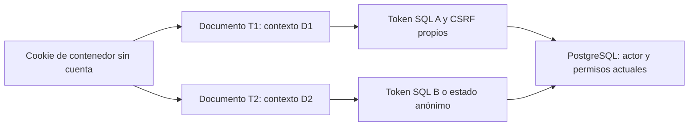
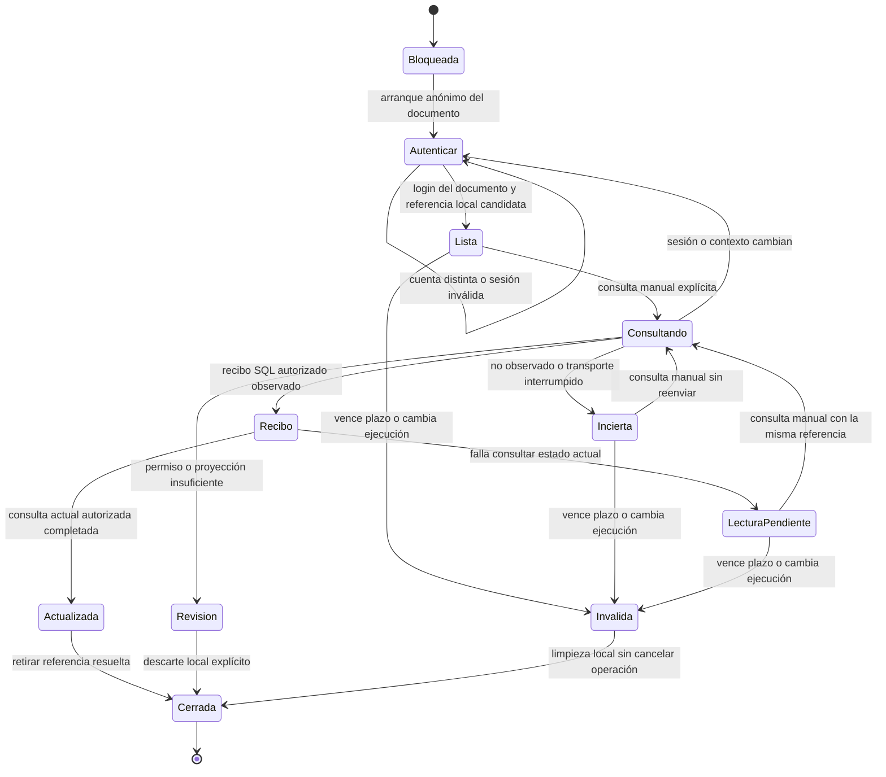

# 5A.4-A — Diseño de recuperación tras recarga

Estado: **propuesta para revisión; ninguna funcionalidad implementada**.
Fecha de revisión documental: 9 de noviembre de 2026.

Repositorio `pepoj1046-svg/proyecto-nexo`. Base exacta:
`3d16680f491ff2c516eb1796b0954a717b49a153`, 5A.3, [PR #9](https://github.com/pepoj1046-svg/proyecto-nexo/pull/9).
Rama exclusivamente documental: `planificacion/etapa-5a4-a`, desde ese SHA.
La autorización de este diseño prevalece sobre el alcance histórico 4A.6 de
AGENTS.md; sus reglas de aislamiento siguen vigentes.

## 1. Conclusión y alcance de la propuesta

**La base permite repetir una operación con su cuerpo original, pero no ofrece
una consulta web por cuenta, familia y clave sin ese cuerpo.** Los recibos existen
en PostgreSQL; no deben exponerse directamente ni leerse con el pool propietario.
Recargar pierde la RAM de 5A.2/5A.3 y, por tanto, también el cuerpo necesario para
repetir. Guardar solamente una clave no elimina esa limitación.

Se recomienda un primer contrato para **reservas APP**, tanto QUEUE como ENROUTE,
incluidos expreso y división ya admitidos. La recuperación nueva sería únicamente
de lectura. Consultar un recibo no repite una reserva ni registra presencia,
abordaje, salida, recepción, custodia o consentimiento.

La propuesta necesita, tras aprobación expresa:

1. Una proyección SQL aditiva y cerrada de recibos APP, sin tablas nuevas.
2. Un endpoint de consulta que la utilice con autenticación renovada.
3. Emisión previa de un ticket con integridad y fechas del servidor. Una fecha
   editable en sessionStorage no acredita por sí sola un máximo de treinta minutos.
4. Un arranque de documento privado que exija reautenticación y oculte todos los
   datos anteriores, independientemente de que el almacenamiento exista o sea válido.

Los puntos 3 y 4 son contratos nuevos a revisar, no capacidades existentes. Su
impacto sobre sesiones y pestañas compartidas se expone en la sección 10. No se
inicia 5A.4-B al aprobar o publicar este documento.

### Decisiones del propietario ya aceptadas

- Recuperación tras recargar y restaurar la misma pestaña cuando el navegador lo permita.
- Vigencia local máxima de treinta minutos desde la creación, sin renovación automática.
- sessionStorage como candidato mínimo, sin promesa de restauración universal.
- Dispositivo compartido, con reautenticación de la cuenta original antes de mostrar datos privados.
- Ningún reenvío automático, operación offline, cuerpo, contraseña, cookie, CSRF,
  consentimiento, manifiesto ni dato de menores almacenado en el ticket.
- PostgreSQL conserva la autoridad de operaciones, recibos, permisos y capacidad.

No se vuelven a solicitar esas decisiones. Lo pendiente es aprobar el mecanismo
concreto que puede cumplirlas y el alcance inicial por familia.

## 2. Evidencia estática de la base exacta

Las rutas siguientes pertenecen al SHA base. La inspección de código es evidencia
estática, no una prueba de ejecución de los contratos nuevos.

| Evidencia | Capacidad comprobada y límite |
| --- | --- |
| [reservation-attempt.ts](../apps/web/src/reservation-attempt.ts#L28) | Attempt conserva cuenta, clave y cuerpo; received conserva respuesta, todo en RAM. submit llama write con el intento original; consult solo consulta. No serializa un ticket. |
| [use-command.ts](../apps/web/src/use-command.ts) | Mapa RAM con clave, cuenta, cuerpo congelado y recibo. retry necesita el intento; consult no reemplaza un resultado incierto por una prueba de éxito. |
| [private-api.ts](../apps/web/src/private-api.ts) | Cookie same-origin, CSRF e Idempotency-Key; límite de espera de 18 s. Agrupa solo GET de sesión en vuelo y ordena login/logout; no almacenamiento persistente. |
| [private-read.ts](../apps/web/src/private-read.ts#L4) | POST de lectura ligado al CSRF original y comprobación posterior de accountRef; evita sustituir la consulta por datos B durante A → B → A. |
| [web-gateway.mjs](../src/http/web-gateway.mjs) | Tabla cerrada de handlers. Los POST privados pasan CSRF y actor. No registra rutas recovery/ticket o recovery/receipt. |
| [web-sessions.mjs](../src/http/web-sessions.mjs) | Handles y CSRF opacos en RAM; login crea sesión web nueva. session puede devolver una cuenta ya autenticada sin pedir otra contraseña. No expone un identificador de ejecución ni una atestación de reautenticación por documento. |
| [001_core.sql](../database/migrations/001_core.sql#L78) | actions tiene actor_id, action_key, payload y result; PK(actor_id, action_key). **No tiene created_at, familia como columna ni TTL de ticket.** |
| [002_operations.sql](../database/migrations/002_operations.sql#L13) | action_start serializa actor+clave con advisory lock y compara todo el payload antes de devolver result. action_finish inserta el recibo dentro de la transacción de negocio. |
| [001, permisos](../database/migrations/001_core.sql#L133) y [002, ACL](../database/migrations/002_operations.sql#L227) | actions tiene RLS habilitada, sin política/grant SELECT para nexo_app. action_start/action_finish son helpers internos, sin EXECUTE concedido a runtime. No abrirlos para esta función. |
| [012_business_operations.sql](../database/migrations/012_business_operations.sql#L2) | reserve_business delega en reserve y valida la cotización dentro de la transacción; su enriquecimiento no es una consulta independiente por clave. |
| [029_queue_assignment.sql](../database/migrations/029_queue_assignment.sql) | reserve y reserve_enroute conservan las claves originales y ajustan recibos dentro de la misma transacción para asignación directa. No convertir recibos históricos HELD en CONFIRMED por inferencia. |
| [web-reservation-service.mjs](../src/db/web-reservation-service.mjs) | reserve confirma el núcleo y luego enriquece la respuesta mediante otras consultas: un fallo HTTP posterior puede ocurrir después del COMMIT. me deriva accountRef de SHA-256 del UUID del actor, truncado a 32 hexadecimales; no es identidad legal. |
| [031_care_responsibilities.sql](../database/migrations/031_care_responsibilities.sql#L73) | care_link_code guarda un código en el result de actions, ligado a la sesión que lo creó. Un nuevo login no renueva ese código ni permite devolverlo mediante una consulta genérica de recibos. |
| [041_administrative_receipt_reads.sql](../database/migrations/041_administrative_receipt_reads.sql) | La lectura del recibo de flota/configuración evita depender de un lock ajeno, pero ocurre dentro del comando, después de action_start(k,p). Exige el cuerpo original; admin_receipt_actor exige permisos administrativos, no sirve como lector universal. |
| [PostgreSQL, 5A2-PG1/PG2](../tests/integration/postgres.test.mjs#L2675) | Ya hay escenarios de COMMIT con enriquecimiento fallido y replay concurrente de grupo dividido. Demuestran recibo con reenvío autorizado del cuerpo original, no recuperación tras recarga sin cuerpo. |
| [contrato 5A.2](ETAPA_5_RECUPERACION_RESERVAS.md), [inventario 5A.3](ETAPA_5_MOVIL_Y_COMANDOS.md) y [ratificación](https://github.com/pepoj1046-svg/proyecto-nexo/pull/9#issuecomment-6620847244) | Son antecedentes. Sus resultados históricos no se atribuyen a una ejecución nueva de 5A.4-A. |

**Demostración de la brecha:** las rutas actuales solo ofrecen listas/consultas
por entidades y comandos con cuerpo validado; ninguna recibe exclusivamente una
clave para leer un recibo. El runtime no puede seleccionar actions ni invocar sus
helpers internos. action_start necesita el payload completo y rechaza otro con
IDEMPOTENCY_CONFLICT. Un operador propietario podría consultar SQL, pero eso no
constituye una capacidad segura del gateway. Coincidir por ruta, precio, grupo o
primera página tampoco identifica qué solicitud produjo la reserva.

## 3. Inventario por familia

Leyenda: **P** = candidato al piloto propuesto; **D** = material suficiente para
diseñar una proyección posterior, pero autorización/DTO por revisar; **X** = no
recuperable por este mecanismo. En la base **ninguna** de estas familias tiene
consulta web de recibo sin cuerpo. P/D no significan funcionalidad implementada.

| Familia web | Recibo nativo / discriminación comprobada | Clasificación y condiciones |
| --- | --- | --- |
| Reservas APP QUEUE, grupo unido, expreso/dividido | reserve: payload.op=reserve y request.source=APP; result con groupId, bookingIds y estado original. 002/012/029; web-reservation-service. | **P**. Cuenta creadora y pasajera actual de todas las partes; conservar tarifa, grupo y asignación. |
| APP ENROUTE | reserve_enroute con trip y request.source=APP; resultado con bookingId/groupId y estado. 019/029. | **P**. Misma propiedad y lectura actual autorizada; no reabrir recogidas ya sobrepasadas ni ofertas vencidas. |
| Reserva presencial WALK_IN | reserve con request.source=WALK_IN; created_by es el operador, passenger_id puede ser NULL. web-terminal-service y 012/029. | **D**. Solo operador original con alcance vigente por asociación/ruta/terminal. Una referencia no permite al responsable reclamar ese recibo; su acceso propio usa el vínculo existente. Fuera del piloto. |
| Presencia, verificación y solicitudes de recogida | correct_arrival / terminal_command y episodio; web-operations-service, 015/016. | **D**. Leer el registro no renueva su vigencia ni demuestra abordaje. Autorizar por reserva y tipo de actor, no solo por ser autor del recibo. |
| BOARD/ALIGHT individuales o de grupo | web_observation y recibo interno derivado; 024 y núcleo de observaciones. | **D**. Consultar solo la clave exterior y proyección mínima. Chofer/operador debe conservar permiso actual; no reconstruir un hecho físico desde el ticket. |
| Aceptación/rechazo de oferta | respond; 013/019/029 y servicios operations/terminal. | **D**. No restaurar ofertas expiradas ni rechazo discrecional de terminales. Autor original y asignación/permiso de lectura vigentes. |
| Salida, progreso, recogidas urbanas, retorno a fila | depart, progress, begin_urban, fleet_command, request_queue; 003/017/019/026. | **D**. Estado histórico distinto de estado actual. Recibo no autoriza otra salida, regreso o movimiento. Las claves internas derivadas no se enumeran. |
| Sustituciones, rescates, traslado y rehabilitación | group_consent, approve_terminal_transfer, terminal_incident_reassign, road_command, fleet_command, restore_vehicle; servicios recovery y 016–019/030. | **D**. Permisos actuales sobre entidades resultantes y origen/destino. No devolver manifiestos o snapshots internos ni reutilizar consentimientos. |
| Recepción segura y discrepancias | handoff / passenger_discrepancy; web-safety-service y 030/032. | **D**. Recepción requiere chofer receptor; reporte requiere responsabilidad actual. Solo confirmación del registro, nunca rectificación o custodia automática. |
| Cancelación/revisión administrativa | web_admin_cancel, cancel, condition_decision; web-management-service y 027. | **D**. Revalidar todas las partes y alcance de terminal; sin reembolso, multa o nueva cancelación. |
| Condiciones y decisiones del responsable | web_declare_condition, web_condition_choice; 028/032 y web-condition-service. | **D**. No convertir una decisión histórica en consentimiento para otra versión/responsable. |
| Responsables, menores, ausencias, excepciones y revisiones | care_responsibility, care_minor, care_absence, care_review, care_exception, care_account; 031/032/035 y web-care-service. | **D**, excluidas del piloto. Hace falta un DTO sin datos de menores y predicados de care_access vigentes. Ni un recibo propio concede autoridad tras corregir el vínculo; ausencia no libera plazas. |
| Código de vinculación de responsable | care_link_code; result.code está ligado a una sesión anterior. | **X** para recuperar el código/capacidad. No almacenarlo, devolverlo ni regenerarlo desde un ticket. Nueva emisión necesita otra actuación explícita; el historial no renueva autoridad. |
| Administración de choferes/contacto | existing_driver_access / association_contact; 035. | **D**. Autor original más driver_admin_lock/ámbito vigente. Proyección futura excluye datos de contacto del ticket y no vuelve a cambiar permisos. |
| Plataforma, flota, rutas/tarifas | platform_admin / fleet_admin / route_and_fare_config; 036/038/039/041. | **D**. Las familias son distintas de la URL y de los subcomandos. Revalidar platform_actor/config_actor y asociación/alcance; excluir body, códigos, motivos y contexto privado de cualquier retorno genérico. |
| Login/logout, contraseña, recuperación de cuenta, mantenimiento | Sesiones/eventos propios de identidad; no son recibos de reserva recuperables por familia+clave. | **X**. No recuperar contraseñas, sesiones revocadas ni capacidades de identidad. El mantenimiento CLI no se expone al navegador. |
| Catálogo, cotización, páginas y manifiestos de lectura | Consultas, no una actuación idempotente registrada en actions por la clave HTTP. | **X** como recibo. Reconsultar según permiso actual; no persistir resultados, parámetros privados o cursores para aparentar continuidad. |

La PK es **actor+clave, no actor+familia+clave**. Cambiar family no permite reutilizar
la clave en otro dominio. El servidor debe verificar el discriminador real y sus
subcampos; nunca devolver result porque solo coincidan actor y clave. Las claves
externas e internas que generan wrappers tampoco son intercambiables.

## 4. Ticket v1 mínimo y plazo fijo

### 4.1 Campos serializados propuestos

Un solo namespace propio de sessionStorage: `nexo:recovery:v1`. Contenedor
versionado con entradas estrictas; sin escribir ni limpiar claves de otros módulos.

| Campo | Contrato |
| --- | --- |
| v | Entero 1. Otras versiones no se interpretan con un esquema permisivo. |
| app | Constante `proyecto-nexo/lab`; no una URL que el ticket pueda seleccionar. |
| environmentId | UUID aleatorio de esta ejecución del gateway. No es el puerto, el hash de cuenta ni X-Request-Id. |
| accountRef | 32 hexadecimales derivados por el servidor con el contrato existente; pseudónimo, no credencial. |
| family | Enumeración cerrada. Piloto: únicamente RESERVATION_APP. |
| key | UUID aleatorio generado por el servidor antes del primer envío. Compatible con actionKey actual; no se admite una clave antigua como entrada de emisión. |
| createdAt | Milisegundos enteros de creación del descriptor, emitidos por servidor. |
| expiresAt | Exactamente createdAt + 1 800 000 ms. Nunca se actualiza al leer, autenticar o recargar. |
| seal | HMAC-SHA-256 en base64url, sobre todos los campos y el origen esperado; clave de firma solo en RAM del servidor. No concede acceso sin login y autorización SQL. |

No serializar received, estado de reserva, resultado, nombres, teléfono, ruta,
precio, IDs de reservas/viajes/miembros, cuerpos, huellas de cuerpos/consentimientos,
contraseñas, cookie, CSRF, token SQL, códigos de vinculación, manifiestos ni datos
de menores. El recibo consultado después de autenticar se conserva únicamente en RAM.
Un hash del cuerpo también puede filtrar decisiones de baja entropía: se excluye.

El sello es integridad de un localizador, no un secreto de autenticación ni un
token bearer. El pseudónimo y la clave siguen siendo metadatos sensibles y no se
muestran antes del login original. No se promete cifrado del almacenamiento.
El ticket no acredita el cuerpo perdido ni firma un consentimiento: el recibo
describe lo registrado por PostgreSQL, no una reconstrucción de lo que el cliente
pretendía enviar.

Propuesta de límites técnicos: ocho entradas y 8 KiB máximos del contenedor UTF-8,
512 bytes por ticket. Validar esquema, tipos, tamaño, UUID, campos permitidos y
fechas; rechazar campos extra y objetos anidados inesperados. No sobrescribir ni
expulsar silenciosamente un ticket vigente para aceptar otra operación. La revisión
puede reducir estos límites sin convertirlos en políticas comerciales.

### 4.2 Emisión previa e integridad del plazo

La base no contiene created_at en actions. No estimar la creación a partir de una
reserva, auditoría, estado local, reloj del navegador o UUID. Tampoco añadir una
fecha retrospectiva inventada a recibos históricos.

Se propone que el servidor emita **clave nueva y descriptor juntos**, antes del
primer comando. Firma una representación canónica con tipos/orden definidos,
incluyendo v, app, origen loopback esperado, environmentId, accountRef, family,
key y ambas fechas. Genera un secreto independiente de sesiones/CSRF al iniciar
el gateway. Verifica longitudes y compara MAC en tiempo constante. Reiniciarlo
invalida el secreto y environmentId; no guardar esa clave en Git, disco o navegador.

La emisión no acepta key ni fechas del cliente: no puede envolver una clave
incierta antigua con otros treinta minutos. Cada emisión tiene otra clave. Leer
un ticket devuelve las mismas fechas; no lo vuelve a firmar. Si se pierde la
respuesta de emisión, aún no hay comando de negocio autorizado por ese flujo:
una emisión manual nueva no recupera ni renueva la anterior.

Se necesita guardar el descriptor correctamente **antes** de despachar el primer
comando, revalidar la cuenta y conservar el cuerpo original solo en RAM durante
ese documento. Recargar entre emisión y envío conduce a consulta, nunca a completar
automáticamente el envío. No convertir un intento 5A.3 sin descriptor previo en
uno recuperable tras perder su cuerpo.

La confirmación inicial congela ese cuerpo en RAM y activa la guardia antes del
primer await, incluida la emisión. Doble clic o navegación no pueden iniciar otro
envío. Antes de persistir y despachar se comprueban cuenta de cotización, descriptor,
boot y contexto actuales; una respuesta tardía de emisión no presta el intento a
otra cuenta. No recalcular cotización, grupos o consentimientos mientras se espera.

El servidor es autoridad del vencimiento lógico. Proponer reloj de proceso
monótono anclado al inicio para medir el intervalo, con fechas de referencia
firmadas. Ante retroceso/anomalía del reloj del servidor o suspensión no evaluable,
invalidar la época de recuperación y fallar cerrado; no extender plazos. Cambiar
el reloj del cliente no extiende la validez. Esta propiedad debe demostrarse con
reloj controlado en B; no está implementada por Date.now de la base.

La vida del laboratorio acopla gateway y base: reiniciar/restaurar/reemplazar la
DB requiere detener el listener y crear otra época de recuperación. No se soporta
intercambiar datos bajo un gateway activo manteniendo su secreto. Pérdida de la
vinculación del pool o duda sobre esa ejecución debe invalidar la recuperación,
no reconectar silenciosamente aceptando tickets del entorno anterior.

**Vigencia no significa borrado físico garantizado:** al estar el navegador cerrado
no corre un temporizador que borre sessionStorage a los treinta minutos. El servidor
rechaza el ticket vencido y la aplicación lo limpia al volver a ejecutarse. Si se
exigiera destrucción física verificable al minuto treinta, este almacenamiento no
puede prometerla y habría que revisar el requisito antes de B.

### 4.3 Limpieza y fallo de almacenamiento

- Comprobar/restaurar solo el namespace propio. Dato corrupto, versión desconocida,
  plazo vencido, otra ejecución u origen incompatible: invalidar sin reenviar.
- Logout explícito elimina los tickets de la cuenta del documento y borra su RAM.
  En la terminal compartida, cambiar de cuenta cierra la recuperación anterior y
  purga sus tickets; no muestra la cuenta anterior ni transfiere la referencia.
  Un login equivocado durante recuperación muestra un rechazo genérico y permite
  volver a autenticar A, sin renderizar datos de A o B. A → B → A nunca restaura
  una respuesta antigua sin consulta nueva.
- Un recibo válido con lectura actual fallida conserva el ticket hasta resolver,
  descartar explícitamente o vencer, con sus fechas originales. Una consulta
  completa autorizada puede retirarlo. Limpiar el ticket no borra el recibo SQL.
- Descartar una referencia requiere explicar que solo elimina ayuda local; no
  cancela, libera plazas, prueba rollback o habilita repetir una actuación distinta.
- Acceso a sessionStorage, parseo y escritura pueden fallar. Para el modo de
  recuperación propuesto, fallar antes del primer envío y comunicarlo; no enviar
  silenciosamente una operación prometiendo que se recuperará tras recarga.
  Una alternativa explícita RAM-only sería una decisión adicional de producto.
- No existe garantía de exclusividad de pestaña: duplicar/window.open puede copiar
  sessionStorage. Ni tabId ni una bandera local prueban unicidad. El clon exige el
  mismo login y solo consulta; no se propone un bloqueo distribuido ficticio.

## 5. Propuesta mínima de transporte y RPC

Todos los nombres siguientes son **propuestos e inexistentes en la base**.
No se ha creado ningún endpoint, RPC, tabla o ticket. La revisión debe aprobar
también el arranque de sesión de 5.1 antes de habilitar lectura privada restaurada.

### 5.1 Revisión complementaria: sesiones y reautenticación entre pestañas

**Esta sección sustituye la propuesta de retirar el handle compartido al servir
HTML del commit 85cd26e. Esa propuesta se descarta:** recargar o autenticar un
documento no debe invalidar el contexto de otros documentos. La cookie compartida
no puede continuar siendo, simultáneamente, la única selección de cuenta de todas
las pestañas y una frontera de autenticación independiente para cada documento.

Se conservan las decisiones aprobadas: treinta minutos no renovables, ticket
mínimo en sessionStorage, reautenticación obligatoria, sin datos privados antes
de verificarla y recuperación solo de lectura. Ninguna arquitectura de esta
sección se ha implementado ni autoriza iniciar 5A.4-B.

#### 5.1.1 Evidencia del comportamiento actual

La inspección corresponde al código funcional heredado de 3d16680, intacto en
85cd26e. Diferenciar el HTML público, la cookie y la sesión SQL es necesario:

| Fuente real | Hecho comprobado |
| --- | --- |
| [web-gateway.mjs](../src/http/web-gateway.mjs) | Cookie trufis_lab_<puerto>, HttpOnly, SameSite=Strict y Path=/. No está particionada por pestaña. El HTML se sirve sin invalidar el handle. login escribe otra cookie y logout la expira. Cada petición captura context antes del await del handler. |
| [web-sessions.mjs](../src/http/web-sessions.mjs) | Un handle selecciona una única entrada con token SQL, CSRF y expiración. login crea otra entrada y elimina la anterior; no comprueba si otra pestaña la usa. actor(context) consulta el token capturado, sin comprobar que la misma entrada siga registrada. |
| [private-api.ts](../apps/web/src/private-api.ts) | sessionRead y authenticationWrite son variables del módulo de cada documento. Ordenan sus propias peticiones, no las de otra pestaña. GET actuales no adjuntan el CSRF; login/logout comparten la cookie del navegador. |
| [main.tsx](../apps/web/src/main.tsx) | recoveryAccount, guardias y formularios son locales al documento. hidden conserva controladores mientras pide la cuenta original. beforeunload advierte, pero no impide recargar ni demuestra privacidad en bfcache. No hay manejo actual de pagehide/pageshow que lo acredite. |
| [Login.tsx](../apps/web/src/Login.tsx) | El formulario consulta la sesión, envía contraseña al login y limpia el campo. No crea un contexto autenticado independiente para su documento. |
| [admin-intent.ts](../apps/web/src/admin-intent.ts) | Sets y Map en RAM conservan intenciones de ese documento; no son un bloqueo compartido entre pestañas ni autoridad de identidad. |
| [010, sesiones SQL](../database/migrations/010_security_and_abuse.sql) | Cada login emite un token distinto con expiración propia. logout revoca el token seleccionado, no todos los tokens del usuario. Este soporte nativo permite separar contextos sin crear otra tabla de identidad. |

Traza deducida del gateway y de esas funciones, con T1 y T2 dentro del **mismo
BrowserContext/perfil**, no dos contextos Playwright aislados:

| Paso | Cookie común y efecto en T1/T2 |
| --- | --- |
| T1 autentica A | Cookie C1 selecciona token A1 y CSRF c1. T2 también envía C1, aunque tenga otra RAM. |
| T2 recarga en la base actual | El HTML no cambia C1. GET /api/session responde A/c1 sin pedir otra contraseña; los paneles pueden cargar datos. No satisface la nueva reautenticación tras recarga. |
| T2 vuelve a autenticar A | Login crea C2/A2/c2 y retira C1. El navegador usa C2 también en T1; un POST de T1 con c1 falla CSRF. GET de T1 puede observar A con otro CSRF. Coincidir en accountRef no demuestra continuidad del contexto. |
| T2 autentica B | La cookie cambia a C3/B/c3. La siguiente consulta de sesión de T1 puede observar B; una intención A debe conservar su cuenta/cuerpo/clave y bloquear su uso por B. No tiene por qué desaparecer la RAM, pero sí se interrumpe su acceso. |
| T2 hace logout | Se revoca el token seleccionado y se expira la cookie compartida. T1 pierde acceso mediante esa cookie, incluso si conserva otro estado en pantalla. No equivale a cancelar su reserva. |
| Petición de T1 capturada antes del cambio | Puede seguir usando el token/context capturado si ya estaba autorizada. Retirar la entrada web no prueba rollback ni invalida retroactivamente ese objeto; una respuesta privada tardía necesita validación de contexto y generación. |

Además, un Set-Cookie anónimo tardío de una pestaña puede competir con el login de
otra. La cola local de private-api no ordena esas respuestas de todo el navegador.
SameSite, HttpOnly y beforeunload no convierten una cookie en una cookie por pestaña.

**Sonda ejecutada en esta revisión:** se importó el módulo real web-sessions.mjs
mediante Node en stdin, con identity/business dobles en memoria y un jar de cookie
simulado. Se comprobaron seis observaciones con aserciones: P1 dos consumidores
ven A; P2 session conserva autenticación y CSRF al simular recarga; P3 login A2
rechaza c1; P4 actor acepta el objeto capturado tras retirar su handle si el token
sigue válido; P5 login B cambia la cuenta observable; P6 logout revoca el token
seleccionado. Las seis observaciones aprobaron. No fue una prueba de dos pestañas
reales, HTTP, PostgreSQL, contraseña, RLS o de la arquitectura propuesta. No se
crearon archivos de tests ni se modificaron datos.

Las pruebas existentes [web-sessions](../tests/web-sessions.test.mjs) y
[orden de autenticación](../tests/web-auth-order.test.mjs) cubren rotación y orden
local, no prueban independencia de dos pestañas con el mismo jar. Se inspeccionaron;
no se ejecutó una batería funcional en esta revisión.

#### 5.1.2 Comparación de alternativas

| Alternativa | Privacidad y efectos secundarios | Evaluación |
| --- | --- | --- |
| Retirar o rotar la cookie al recargar HTML | Puede forzar login del documento nuevo, pero invalida el acceso de todas las pestañas que la usan y compite con respuestas en vuelo. | Descartada por el requisito de conservación entre pestañas. |
| Mantener cookie de cuenta y añadir reauthenticated=true/tabId en el navegador | Evita esa rotación, pero el indicador es manipulable y el servidor aún entrega datos privados mediante la cookie antigua. | No cumple. Un gate solo visual o activado por el ticket tampoco cumple. |
| Mantener cookie de cuenta y añadir solo un grant al endpoint de recibos | Puede proteger esa lectura; otros GET/POST privados siguen dependiendo del actor global. Login B vuelve a afectar a T1 y puede mezclar vistas. | Insuficiente para las garantías completas. Si se extiende correctamente a todos los handlers, converge en los contextos siguientes. |
| Credencial/cookie, ruta u origen diferente por documento | No es aislamiento de pestaña por sí solo: cookies se comparten y duplicar URL puede copiar el ámbito. Introduce rutas/cookies y gestión adicional. | Más complejo y sin resolver automáticamente frescura o bfcache. No se propone. |
| Cookie de contenedor sin cuenta + contexto autenticado por documento en RAM | Cookie no selecciona actor. Cada documento conserva token SQL y CSRF propios; nueva carga crea un contexto anónimo sin retirar otros. | Recomendada: adaptación central de las sesiones actuales, sin proveedor, tabla de identidad o inventario nuevo. |

La recomendación es la alternativa de menor complejidad **que cumple todos los
requisitos**, no una corrección de un solo botón. Requiere revisar los handlers
privados comunes, el transporte y el gate de main. Limitarla al lector de tickets
mientras las rutas antiguas aceptan la cookie sola dejaría un bypass.

#### 5.1.3 Arquitectura recomendada y prueba de reautenticación

Separar dos niveles en la RAM del gateway:

- **Contenedor de navegador:** handle aleatorio HttpOnly, SameSite y origen/puerto
  verificados. Agrupa contextos, pero no contiene una cuenta activa predeterminada
  ni permite acceder a su lista de documentos, tokens o CSRF autenticados.
- **Contexto lógico de documento:** selector opaco D, generación G, estado de
  autenticación, token SQL, accountRef derivado y CSRF aleatorio propios, con su
  expiración. Solo el gateway crea/transiciona este registro. D no es una credencial.
  Los secretos SQL permanecen en servidor; D/G/CSRF de cliente solo viven en RAM.

Contrato de bootstrap/login, por revisar antes de programar:

1. Cargar HTML no retira ni sustituye el contenedor válido o los contextos de otras
   pestañas. Una nueva instancia JS o una restauración que exige reautenticación
   comienza bloqueada. Sin prueba privada en RAM, GET /api/session solo obtiene
   un **contexto anónimo nuevo** D y su CSRF de bootstrap, nunca datos de una cuenta
   ya autenticada. Puede reutilizarse esa ruta existente; no se necesita proponer
   otro endpoint de identidad. El selector se genera en servidor, no se acepta un
   tabId del cliente para reemplazar un contexto existente.
   El bootstrap se pide sin selector autenticado. Un D autenticado con prueba
   ausente/incorrecta se rechaza; no devuelve un secreto nuevo ni se degrada a
   anónimo. Solo el arranque o una reautenticación explícita instalan en el cliente
   el nuevo contexto anónimo; un error de una petición no cambia el transporte.
2. Login explícito presenta D, cookie, Origin y CSRF de bootstrap, además de las
   credenciales ya admitidas. identity.login vuelve a verificar contraseña/versión/
   actividad y emite una sesión SQL independiente. Tras verificar la identidad, el
   servidor instala el contexto autenticado y emite **otro CSRF secreto** en esa
   respuesta. El CSRF de bootstrap queda consumido; no se admite para reautenticar
   un contexto que ya está autenticado.
3. Cada lectura o escritura privada requiere cookie de contenedor + D + CSRF de
   ese contexto, también en GET privados. Reutilizar X-CSRF-Token y un selector
   cerrado, por ejemplo X-Nexo-Document; ambos se verifican, no se confían. El CSRF
   autenticado sirve además como prueba de posesión del contexto en RAM. D, cookie,
   ticket, accountRef o un booleano, solos o combinados sin esa prueba, no autorizan.
4. GET /api/session con D conocido pero sin su prueba válida no devuelve su CSRF,
   accountRef o estado privado. Crear un contexto anónimo tampoco puede degradar
   o sobreescribir otro autenticado con ese D. No hay operación para recuperar el
   secreto autenticado mediante cookie + selector o mediante un ticket válido.
5. Un nuevo documento no obtiene la prueba de la RAM de otra pestaña. No guardar
   D/G/CSRF, tokens o flags autenticantes en sessionStorage, localStorage, URL,
   window.name, history.state, BroadcastChannel, service worker o el ticket. Los
   únicos campos persistidos siguen siendo los del ticket de la sección 4.
6. Para reautenticar un contexto existente se exige su prueba actual y nueva
   verificación de contraseña; si se perdió/expiró la prueba se crea otro contexto
   anónimo, no se resetea otro D por conocerlo. Cada login autorizado cambia G y
   CSRF solo en ese contexto. Una cookie válida no equivale a nueva contraseña.
7. Las respuestas de login se instalan con comparación del registro/generación
   capturados antes de sus awaits. Dos login concurrentes no pueden reinstalar una
   versión vieja ni devolver una prueba activa del contexto perdedor. Una sesión SQL
   emitida pero no instalada no se devuelve al navegador; su revocación de limpieza
   es una operación de seguridad acotada, no una cancelación de negocio.

El contenedor se mantiene estable durante recarga, login y reautenticación de un
documento. No escribir en él la nueva cuenta ni rotar su valor por esos eventos.
Si hay que reemitir la misma cookie por su mantenimiento, no cambia autoridad o
pruebas de otros documentos, ni renueva plazos de tickets o sesiones SQL. Su
creación inicial puede competir entre dos pestañas sin cookie: se debe comprobar
la vinculación efectiva antes de permitir cualquier operación; si se perdió,
fallar cerrado sin transferir contextos o reenviar comandos.

**Qué prueba el servidor:** existe un contexto ligado a ese contenedor, creado o
renovado tras verificar realmente credenciales con la identidad existente, con
prueba de posesión y sesión SQL vigente. **Qué no puede probar HTTP:** que D sea
una pestaña física única o que nadie copió credenciales completas de un navegador
comprometido. Un XSS/operador con todos los secretos de una sesión puede usarlos;
no presentar un nonce como atestación de documento, identidad legal o presencia
humana. La defensa contra una bandera/ticket manipulado no es una defensa absoluta
contra robo de las credenciales activas.

#### 5.1.4 Fronteras de autorización y respuestas tardías

- Aplicar el contrato a **todos** los handlers privados de la app, incluidos GET
  de sesión autenticada, reservas propias y ofertas. El bootstrap/login anónimos
  son excepciones cerradas sin datos privados; catálogo público sigue siendo público.
  No admitir fallback cookie-only o selección del primer contexto autenticado.
- Derivar el token desde el contexto registrado y pasarlo a los servicios actuales.
  PostgreSQL sigue verificando actor, revocación, rol, asociación y terminal. D o G
  no seleccionan libremente usuario/SQL y no reemplazan RLS.
- Comprobar pertenencia viva al Map, contenedor, generación, prueba y vencimiento
  antes del servicio y antes de entregar datos privados. No reutilizar solamente
  el objeto context capturado; ese es precisamente el límite observado en P4.
- En el cliente, capturar entorno, D/G, cuenta e intención/generación de consulta.
  Incrementar la generación de presentación al comenzar una autenticación, logout
  o restauración, antes de esperar red. Un GET/login/recibo A1 tardío no se publica
  después de B o A2, aunque accountRef vuelva a coincidir.
- Comprobar también esa captura antes de despachar tras cualquier await/cola.
  Si cambió el contexto propio, una continuación antigua no envía el comando con
  credenciales nuevas, aunque la cuenta vuelva a ser A. Conserva el intento y pide
  acción manual; el login no lo reanuda automáticamente. Cambiar D2 no modifica la
  captura D1 de una operación que el usuario de T1 ya inició.
- Mantener las colas de private-api por documento. No hace falta un mutex de login
  global entre pestañas ni copiar sus credenciales mediante mensajes. Respuestas
  antiguas no reinstalan pruebas ni reemplazan un contenedor activo.
- La vigencia del contexto no supera su sesión SQL; otro login no la prolonga.
  Caducar/revocar un hijo invalida ese hijo. Expirar/borrar el contenedor o revocar
  globalmente la identidad puede afectar a todos: es una frontera de seguridad
  explícita, no un efecto secundario de recargar una pestaña.
- Mantener límites globales de memoria y tráfico, sin ampliarlos ni expulsar
  contextos activos para aceptar uno nuevo. Saturación devuelve rechazo al nuevo
  bootstrap; no elimina intentos ni cancela operaciones existentes. No se promete
  disponibilidad absoluta frente a abuso o borrado externo de cookies.

No se requiere SQL nuevo para almacenar contextos web: se reutilizan las sesiones
SQL independientes existentes y el Map del gateway. La RPC de recibos de 5.4 sigue
siendo la propuesta aditiva separada. Sí cambia el protocolo privado común y sus
pruebas; no debe coexistir con una vía antigua que permita recuperar autoridad de
cuenta solo mediante cookie. La transición se prueba en laboratorio, sin prometer
compatibilidad de sesiones activas entre versiones o reinicios del gateway.

#### 5.1.5 Reservas y comandos pendientes de 5A.2/5A.3

| Evento | Documento afectado | Otros documentos |
| --- | --- | --- |
| T2 recarga o autentica A/B | T2 exige login nuevo; ticket solo consulta. Si T2 perdió su cuerpo al recargar, no puede reenviarlo. | D1/token/CSRF y controladores de T1 no se sustituyen; una petición de T1 sigue con su actor original. |
| T2 reautentica manteniendo su RAM | Mantener montado el controlador/Attempt, su cuenta, clave, cuerpo y recibo. Actualizar transporte solo tras autenticar la cuenta requerida; ocultar datos mientras tanto. | No cambia el acceso de T1 ni sus intenciones. |
| T2 hace logout explícito | Revocar el token SQL de T2 mediante logout nativo, retirar solo su contexto y limpiar su RAM/tickets locales. Conservar la guardia de logout si su propio intento está pendiente. | No expirar el contenedor común ni revocar tokens de T1. La interfaz debe explicar «Cerrar sesión de esta pestaña». |
| Revocación administrativa, logout_all ya autorizado o pérdida global del entorno | Fallar cerrado en el alcance revocado. La RAM no concede acceso ni prueba rollback. | Puede afectar a varios contextos por su contrato de seguridad; no se añade una acción global nueva en esta revisión. |
| pagehide/bfcache de T2 | Bloquear su presentación antes de congelar, retirar su prueba de autenticación de uso en RAM e invalidar callbacks; mantener la intención privada en RAM si el navegador conserva el documento. Al volver, bootstrap nuevo y contraseña, sin replay automático. | No ejecutar logout/reset global ni desmontar T1. |

Mantener el significado de los controladores originales: freeze del cuerpo antes
del await, key y cuenta originales, bloqueo de otra intención y recibo recibido
separado de fallo de actualización. Un contexto nuevo de la misma cuenta puede
recuperar una intención RAM mediante acción manual y permisos actuales; no se
recalcula el cuerpo o consentimiento para adaptarlo al login. En recuperación tras
recarga falta ese cuerpo: únicamente consulta según el ticket, nunca retry del
comando original.

Una respuesta perdida/cambio de contexto puede conservar UNCERTAIN incluso si hubo
COMMIT. Un recibo confirmado no ocasiona otro POST por fallar su consulta. No vaciar
attempts, cambiar keys de React o llamar dispose solo porque T2 autenticó otra
cuenta. Las vistas pueden bloquearse sin destruir sus controladores de intención.
Tras cambiar de contexto propio, su respuesta antigua queda privada y una consulta
manual nueva exige cuenta original; A → B → A no restaura callbacks antiguos.

No llamar logout ni mutadores por beforeunload/pagehide: no son una confirmación
fiable de cierre. En bfcache hay que impedir pintura y consultas privadas antes
del nuevo login, además de conservar las intenciones en el documento que realmente
siga en RAM. Debe demostrarse con el navegador; ocultar tarde en pageshow o confiar
solo en Cache-Control:no-store no acredita ausencia de flash. No se prometen
recuperación de RAM destruida, eliminación de miniaturas del SO ni privacidad de
otra pestaña ya abierta y autenticada frente a quien controla físicamente el equipo.

#### 5.1.6 Pruebas reproducibles necesarias antes de aceptar B

Diseño de pruebas, **no implementación ni ejecuciones nuevas de PostgreSQL/E2E**.
Usar el gateway auténtico y el runner de laboratorio con datos ficticios. Para
comparar pestañas, crear T1/T2/T3 con browserContext.newPage() dentro del **mismo**
contexto Playwright; crear dos browser.newContext() no prueba cookie compartida.
Usar dos cuentas A/B y, en los casos de permisos, pasajero/chofer/administrador de
asociaciones distintas. No simular la autorización reemplazando todo el gateway.

| ID | Caso reproducible | Evidencia y aceptación |
| --- | --- | --- |
| S01 | Caracterizar la base: T1 login A, T2 recarga/login A/login B/logout. Capturar cookie/CSRF solo en RAM del test. | En la base se observa cambio compartido; no se presenta como aprobación del contrato nuevo. Comparar después con los mismos pasos del candidato. |
| S02 | T1 hace reserva real; esperar COMMIT con route.fetch y retener solo su respuesta. T2 recarga y autentica B antes de liberar la respuesta de T1. | T1 obtiene su resultado A autorizado; cookie-contenedor y contexto D1 no cambian. Una reserva/recibo/auditoría por key, mismo grupo/precio y capacidad por segmento. |
| S03 | Pausar T1 antes del COMMIT mediante barrera controlada SQL; T2 autentica/recarga y luego liberar T1. Repetir con rollback real. | El resultado depende de la transacción original, no de T2. No crear replays ni inferir rollback por la recarga. |
| S04 | T1 A con BOARD u otro comando pendiente; T2 alterna A → B → A mientras se demoran sus respuestas. | Token/actor de T1 siguen siendo A; datos antiguos de T2 no se repueblan. No segundo movimiento, cancelación o cambio de custodia. |
| S05 | Con cookie común y D1 conocido, T2 omite o falsifica prueba; intenta GET de sesión, lectura, comando y login sobre D1. | No obtiene CSRF autenticado, cuenta o datos, ni sobrescribe D1. CSRF de bootstrap consumido no autoriza otro login sobre un contexto autenticado. |
| S06 | Recargar T2 con ticket válido, borrado, corrupto y flags/tabId inyectados en storage; mantener cookie A. | Cero datos visibles y cero consultas privadas antes del login exigido. Ningún campo local activa autoridad; ticket válido tampoco crea contexto autenticado. |
| S07 | Navegar T2 fuera y volver por bfcache con lectura pendiente; conservar T1 activo. Usar trazas/frames y pageshow.persisted. | Sin flash/árbol accesible privado antes del login ni callbacks viejos; T1 intacto. Si el navegador no reproduce bfcache, declararlo no verificado. |
| S08 | Duplicar T2/window.open y comprobar copia de sessionStorage, con intentos simultáneos de recuperación. | Contextos anónimos distintos; no se copian pruebas. Cada uno exige login; misma referencia consulta el recibo sin escrituras ni renovación del plazo. |
| S09 | Logout explícito de T2 y logout bloqueado por intento propio pendiente; T1 mantiene petición en vuelo. | Se revoca solo token T2 cuando proceda; T1 sigue válido. No se expira la cookie común ni se borran intentos/tickets de otra pestaña. |
| S10 | Caducar un contexto, revocar un token y revocar identidad/rol por los mecanismos existentes, con barreras de consulta. | Afectación según alcance real; nueva autenticación no amplía permisos. Distinguir rechazo de una operación ya autorizada que puede terminar. |
| S11 | Dos login de un mismo documento con respuestas inversas; login fallido y cuenta equivocada durante recuperación. | Comparación de versión antes de instalar el contexto; ninguna respuesta vieja reinstala pruebas o datos. Intento original queda conservado y oculto. |
| S12 | Dos primeras aperturas sin cookie y respuestas bootstrap tardías; cookie borrada/expirada externamente. | Vinculación verificada o fallo cerrado, sin reanudar comandos ni transferir contextos. No hay sustitución de cookie de cuenta durante login normal. |
| S13 | T1 ya recibió recibo y su actualización falla; T2 reautentica mientras T1 recupera manualmente. | T1 conserva recibo y hace solo lectura, cero POST adicionales de negocio. Repetir con respuesta perdida sin recibo y cuerpo RAM para exigir la key/cuerpo originales en el replay manual de T1. |
| S14 | Ticket a 29:59.999/30:00, recargas y nuevos login en T2, respuesta de recibo tardía. | createdAt/expiresAt/key invariables; no se persisten D/G/CSRF o tokens, no se muestra como vigente tras vencer y no se renueva al autenticar. |
| S15 | Origen/CSRF falsos, otro contenedor, rol/asociación ajenos, bootstrap masivo y límites de memoria/tráfico. | Controles completos de todos los handlers; sin fallback cookie-only, filtración de claves o expulsión de contextos activos. Rechazos no alteran negocio. |
| S16 | Regresión de las máquinas 5A.2/5A.3, desktop/móvil, teclado/320 px/200 %, cierre/reinicio, CI y CodeQL. | Conservar pruebas anteriores y añadir estas brechas; resultados reales del SHA funcional. No aumentar timeouts/retries ni debilitar aserciones. |

En S02/S03, el interceptor controla transporte después de ejecutar contra PostgreSQL
real; no fabrica un recibo exitoso. Los testigos SQL comparan reservas, miembros,
precios/versiones, segmentos, cola, movimientos, custodia, acciones y auditoría de
negocio. Autenticación emite/revoca sesiones y sus eventos legítimos: verificarlos
por separado en vez de exigir que toda la DB permanezca idéntica después del login.
No guardar cookies, pruebas, contraseñas, cuerpos o datos privados en los artefactos.

Las expectativas antiguas de rotación de cookie global deben revisarse de forma
explícita al cambiar el protocolo: la defensa pasa a ser rotación de contexto/CSRF
del documento y cookie común sin actor. No basta borrar una aserción de seguridad
para aprobar el candidato. Los contratos de inventario, roles y recibos conservan
sus regresiones; S01 mantiene documentado el comportamiento anterior.

#### 5.1.7 Dictamen de la revisión complementaria

El arranque que retira el handle común **no es aceptable** para el requisito nuevo
sobre otras pestañas. Se recomienda contenedor sin autoridad y contextos autenticados
por documento, con verificación SQL independiente y prueba RAM exigida en todos los
handlers privados. No necesita nueva infraestructura de identidad ni persistencia
adicional de credenciales; sí una adaptación explícita del protocolo común.

**5A.4-B no debe comenzar con el contrato anterior y no queda autorizado por esta
revisión.** El contrato corregido es una base técnica viable para que el propietario
lo revise y autorice expresamente. Sus garantías de runtime, privacidad en bfcache
con conservación de intenciones, y aislamiento con varias pestañas quedan como gates
obligatorios a demostrar durante B; no se declaran probadas por una sonda de módulo.
No se cambia el ticket de treinta minutos ni el resto de decisiones aprobadas.

### 5.2 Emisión: POST /api/recovery/ticket

- Entrada cerrada: `{v:1,family:"RESERVATION_APP"}`. Sin actor, key anterior, fechas,
  associationId, SQL, URL de retorno o parámetros del comando.
- Exige sesión web autenticada mediante login de ese boot, todavía vigente, CSRF/Origin y actor SQL
  vigentes. Genera key, fechas y seal; devuelve exclusivamente el ticket v1.
- La consulta de identidad usa el pool correspondiente existente; firmar metadatos
  no inserta actions ni modifica reservas, recibos o auditoría de negocio.
- Un ticket emitido no confirma que se haya enviado ni recibido una reserva. No se
  reutiliza la caducidad de la sesión de una hora como TTL del ticket de treinta minutos.
- No hay reemisión con otra fecha para una clave existente. Retomar un ticket usa
  únicamente el endpoint siguiente. Esta emisión previa adicional es necesaria
  para acreditar el plazo sin una nueva tabla de metadatos.

### 5.3 Consulta: POST /api/recovery/receipt

- Entrada cerrada: `{v:1,ticket:<ticket v1>}`. Lectura explícita de **una** clave;
  sin body original, filtros, lotes, roles, asociaciones o paginación de actions.
- Pasar por los handlers privados cerrados: Origin exacto, CSRF del contexto nuevo,
  cookie HttpOnly/SameSite, JSON y límites actuales. No GET, query string, URL
  derivada del ticket o Idempotency-Key que invoque una escritura.
- Tras autenticar, validar sello, versión, aplicación, origen esperado, ejecución, plazo fijo y
  familia; derivar actor de sesión SQL y comparar accountRef. Revalidar contenedor y contexto/generación del documento según 5.1. Comprobar nuevamente el plazo justo antes de responder: una consulta
  iniciada antes de vencer no extiende la referencia mientras espera. Una firma
  válida no reemplaza permisos o reautenticación.
- El HTTP 200 es una respuesta a la consulta, no una nueva reserva. Respuestas
  privadas usan no-store. No registrar claves completas, sellos, cuerpos o resultados
  en URLs, telemetría, consola, eventos ni mensajes de error.

| Respuesta propuesta | Significado y DTO permitido |
| --- | --- |
| 200 / RECORDED | Hay recibo APP de esa cuenta, de la familia esperada y con referencias actualmente autorizadas. Devolver family, key, environmentId, observedAt y `receipt:{operation,groupId,bookingIds,originalStatus}`. operation solo reserve/reserve_enroute; IDs completos y únicos, sin campos arbitrarios. |
| 200 / NOT_OBSERVED | No se observó un recibo autorizado en esta consulta, incluida contención no resuelta. Sin IDs ni resultado. **No significa no ejecutada ni autoriza un reenvío.** |
| 401 / REAUTHENTICATION_REQUIRED | No hay autenticación original vigente en el boot actual; ocultar datos y recuperar acceso mediante login. |
| 403 / RECOVERY_UNAVAILABLE | Cuenta distinta, permiso/propiedad insuficiente, familia real diferente o resultado no proyectable. Igual forma sin confirmar existencia del recibo ajeno o motivo privado. |
| 400 / INVALID_RECOVERY_TICKET | Esquema/firma no válidos; no consultar actions con datos no verificados. |
| 410 / RECOVERY_TICKET_EXPIRED o ENVIRONMENT_CHANGED | Referencia inválida para recuperación. No renovar ni consultar el entorno anterior. |
| 429 o 503 | Mantener incertidumbre y ofrecer consulta manual posterior sin cambiar key/fechas; respetar límites existentes, sin tormenta de consultas. |

El DTO de recibo no es el ReservationReceipt enriquecido de 5A.2 y no se inyecta
en su máquina como si tuviera cuerpo original o estado actual. Se necesita una
máquina de consulta restaurada separada. `originalStatus` es el valor guardado,
no CONFIRMED por defecto. No devolver payload ni result crudos: podrían contener
un código de vinculación, datos de otros grupos o subcomandos incompatibles.

El cliente tampoco publica una respuesta entregada tarde si la referencia ya no
es válida. Para representar tiempo restante puede usar observedAt del servidor
y un margen conservador que reste el RTT medido con reloj monótono; nunca asignar
otros treinta minutos al recibirla. Si no puede evaluar la vigencia, vuelve al
gate y la consulta manual, sin mostrar un recibo como recién recuperado.

Para consultar estado actual se reutiliza POST /api/reservations/page y su
paginación OWN, con CSRF original y generación vigente. Identificar por bookingIds
autorizados, no coincidencias de precio/ruta. Una página incompleta no prueba ausencia;
no se requiere que todos los IDs estén en sus primeros cincuenta registros. Si esa
consulta falla, distinguir recibo observado de lectura actual pendiente; nunca
convertir ese fallo en un nuevo POST de reserva.

### 5.4 RPC aditiva propuesta y límites de RLS

Propuesta: `nexo.web_app_reservation_receipt(k text)` devuelve únicamente la
proyección anterior o NOT_OBSERVED, en una transacción READ COMMITTED READ ONLY.
La familia del piloto es fija: no pasar nombre de función, tabla, actor ni SQL.

Contrato SQL requerido antes de implementarla:

1. require_actor y revalidación de sesión real/identidad vigente, usando el token
   de contexto establecido exclusivamente por el servidor. nexo_app conserva
   NOSUPERUSER/NOBYPASSRLS y no adquiere credenciales de identidad o propietario.
2. Buscar la PK **actor_id=actor actual AND action_key=k**, con una sola fila
   candidata. La familia deriva de payload.op y source, no de un campo del cliente.
   Solo reserve/reserve_enroute y request.source=APP. Otros formatos fallan cerrado.
3. Validar groupId/bookingIds del resultado y todas sus referencias. Cada reserva
   debe ser APP, de la cuenta creadora/pasajera actual y pertenecer al grupo esperado;
   no devolver partes de otro actor ni respuestas parciales de un grupo dividido.
   Aplicar el ámbito de lectura vigente y las restricciones de ruta que correspondan,
   sin usar autoría del recibo para saltar revocación o RLS.
4. SECURITY DEFINER con search_path fijo pg_catalog,nexo,pg_temp y objetos
   cualificados, según el patrón del núcleo. Su lectura interna de actions necesita
   filtro explícito: el dueño puede eludir RLS. No asumir que SELECT bajo el dueño
   aplica las políticas de nexo_app; verificar propiedad y alcance antes del DTO.
5. REVOKE de PUBLIC y de roles identidad/provisión/mantenimiento; solo EXECUTE
   específico para nexo_app. Mantener sin SELECT/DML a actions y sin EXECUTE a
   action_start/action_finish. No añadir una política amplia de lectura propia a
   actions, pues expondría todos los tipos de payload/result del actor.
6. Consultar el registro de reserva, no volver a evaluar disponibilidad como si
   se fuera a reservar. No expire_holds, action_finish, mutadores, versiones nuevas,
   marcas de consumo, auditoría de negocio ni actualizaciones por lectura.

La asociación/ruta del ticket nunca concede permisos. Tampoco se requiere que una
ruta histórica siga vendiéndose para leer lo que las consultas OWN ya autorizan;
no confundir autorización de lectura con elegibilidad para una reserva nueva.
Si no puede demostrarse una proyección compatible con la lectura vigente, responder
RECOVERY_UNAVAILABLE y bloquear ese perfil, no ampliar las reglas para recuperarlo.

### 5.5 Concurrencia y consistencia

El escritor nativo ya serializa actor+clave con el hash de action_start. Proponer
al lector `pg_try_advisory_xact_lock_shared` sobre **el mismo** identificador, sin
espera: si no lo obtiene, NOT_OBSERVED. No afirmar que la clave está ejecutándose,
pues puede existir contención o colisión de hash. Lectura acotada y liberación al
cerrar la transacción; no introducir otro orden de locks de rutas/inventario.

Si obtiene el lock, proyectar solo filas confirmadas, en un snapshot coherente.
Revalidar sesión, expiración por reloj real y propiedad al final. Definir la función
VOLATILE para no reutilizar una lectura de autorización anterior tras una espera.
No usar FOR SHARE/UPDATE en una transacción READ ONLY: no se copia sin más el
helper administrativo 041, que usa locks de fila y exige administrador.

Una petición puede llegar al escritor **después** de que el lector no observe nada.
Un rollback y una petición aún no recibida no se distinguen por NOT_OBSERVED. El
cliente restaurado no conserva el cuerpo y, por tanto, no tiene botón de replay.
Ofrece consulta manual o revisión; no crea automáticamente otra clave.

La revocación se comprueba antes de publicar y las respuestas tardías se descartan.
No se promete retirar bytes ya entregados ni abortar retroactivamente una operación
autorizada. Los tests deben fijar barreras reales de concurrencia para demostrar
esa frontera y no presentar un estado local como autorización SQL.

### 5.6 Necesidad de migración y alternativa descartada

Se necesita una **migración aditiva 042 o siguiente libre**, solo si se aprueba B,
para crear la proyección/ACL. La PK existente basta; no se justifica otro índice,
tabla de recibos, campo created_at inventado, segundo inventario ni cambiar 001–041.
El ticket firmado y su caducidad son del protocolo de recuperación, no una política
de retención o borrado de actions. Los recibos históricos siguen bajo sus contratos.

Un ticket cliente sin sello permitiría editar fechas/cuenta/familia y no acreditar
el plazo. Una tabla nueva podría anclar el tiempo, pero requeriría escrituras,
retención y mantenimiento adicionales. Se propone la emisión firmada previa para
evitar esa tabla. No es posible simultáneamente conservar claves antiguas sin fecha,
ofrecer creación acreditada no renovable y añadir solamente una consulta por clave:
si se rechaza la emisión previa, esa garantía queda bloqueada y debe revisarse.

## 6. Amenazas, garantías y límites

| Amenaza / caso | Tratamiento exigido | Garantía que no se promete |
| --- | --- | --- |
| XSS, dependencia comprometida o extensión privilegiada | Mantener CSP sin scripts externos, renderizado sin HTML inyectado, datos mínimos, sello y reautenticación. No guardar credenciales ni claves de firma. | XSS activo puede leer sessionStorage, DOM y capturar credenciales nuevas. Ni cifrar con una clave en el mismo navegador ni HttpOnly lo resuelven. Requiere auditoría y riesgo residual reconocido. |
| Otra persona usa el equipo con cookie A | Arranque anónimo y pantalla bloqueada independientes del ticket; contraseña original antes de datos. Logout y limpieza explícitos al ceder terminal. | Una bandera local no prueba que el humano actual sea A; miniaturas/SO y otra pestaña ya abierta quedan fuera de esa promesa. |
| Ticket editado, copiado, fecha futura o reloj cliente atrás | Esquema cerrado, MAC, ejecución, cuenta real y plazo del servidor. Manipulación no consulta ni modifica otra cuenta. | El ticket no es confidencial ni prueba custodia, identidad legal o autorización de un responsable. |
| Pestaña duplicada / window.open | Suponer copia del ticket; nuevo documento exige login. Dos lectores autorizados no escriben. No usar tabId como ACL. | Exclusividad de pestaña o recuperación de una pestaña que el navegador no restaura. |
| A → B → A y respuesta lenta | CSRF ligado al contexto, handle/boot vigentes, cuenta original y generación de consulta; invalidar callbacks viejos antes de publicar. | Una comparación aislada de accountRef antes/después no detecta todos los cambios de contexto. |
| Sesión caducada/revocada, permisos retirados o responsable corregido | Reautenticar y revalidar SQL; negar lectura si el perfil actual no la permite. No usar sello/autoría para ampliar acceso. | Recuperar una sesión revocada, un código anterior o autoridad de tutela. |
| COMMIT con respuesta perdida; lectura antes del COMMIT | RECORDED solo por recibo SQL autorizado; NOT_OBSERVED conserva incertidumbre. | Rollback por timeout, página vacía o lock libre; cancelación o liberación automática. |
| Recibo confirmado, estado actual fallido o cambiado | Mostrar registro histórico y consulta pendiente por separado, ambos solo después de login. Reintentar lectura. | Que el estado original siga vigente, que HELD sea CONFIRMED o que seis plazas signifiquen salida. |
| Reinicio del gateway/DB, mismo puerto o IDs reutilizados | Nueva época y secreto; invalidar tickets anteriores incluso si la cuenta parece igual. Si cambia puerto, sessionStorage pertenece a otro origen y puede no estar accesible. | Continuidad del ticket entre ejecuciones de laboratorio, migrarlo o resignarlo automáticamente. |
| Enumeración o abuso | Emisor no acepta claves elegidas; lector MAC+actor+familia cerrada; errores opacos, límites actuales 120/min y seis simultáneas, respuesta acotada. | Constancia temporal absoluta o protección distribuida/productiva que la base no ofrece. |
| Caída tras emisión y antes de envío; cuota/almacenamiento bloqueado | Persistir antes del primer envío, parar si falla. Restore consulta únicamente. | Que haya una reserva por existir ticket, o envío posterior automático del cuerpo perdido. |
| Caducidad, limpieza manual o navegador cerrado | Invalidez lógica por servidor, limpieza local al ejecutar; no renovar. Revisión normal con permisos actuales. | Borrado físico verificable en navegador cerrado ni borrado de operaciones/recibos SQL a los treinta minutos. |

## 7. Máquina de estados y mensajes accesibles

Son estados del cliente de recuperación, no nuevas columnas/estados de reserva.
El estado inicial siempre oculta datos privados; el recibo y el estado actual
solamente existen en RAM después de la autorización.

Lista no certifica el MAC ni la cuenta original de un objeto local: esa comprobación
es del servidor, y solo una consulta autorizada puede desbloquear la información
privada del flujo restaurado. El gate de caducidad/contexto se evalúa también antes
de cualquier transición o publicación, aunque el diagrama no repita todas sus flechas. Consultando se serializa
por ticket para evitar consultas simultáneas accidentales. No hay transición a
reservar, reenviar, confirmar oferta, abordar, salir o aceptar condiciones.

| Estado | Mensaje propuesto / acción |
| --- | --- |
| Bloqueada / Autenticar | «Inicia sesión con la cuenta original para consultar una operación anterior». Sin nombre, cuenta, familia, ruta, número de referencias o resumen privado. |
| Lista | «Iniciaste sesión. Puedes consultar esta referencia; el servidor todavía debe verificarla. La operación no se repetirá». Botón «Consultar resultado». |
| Consultando | «Consultando el resultado autorizado. La operación no se está reenviando». aria-busy y botones de consulta deshabilitados durante la petición. |
| Incierta | «Todavía no se observó un recibo. La operación pudo ejecutarse o seguir pendiente. Puedes volver a consultar». Sin botón «Reservar otra vez». |
| Recibo / LecturaPendiente | «El servidor confirmó un registro anterior; falta consultar su estado actual». La condición original se identifica como histórica, sin presentarla como disponibilidad actual. |
| Revision | «No podemos recuperar esta referencia con los permisos actuales. Requiere revisión». No afirmar recibo ajeno, sanción, cancelación o reembolso. |
| Invalida | «La referencia temporal caducó o corresponde a otra ejecución. No se canceló ninguna operación». Consulta normal solo tras autenticar. |
| Error de almacenamiento antes del envío | «No se pudo guardar la referencia temporal. Esta solicitud no se ha enviado desde este intento». No prometer continuidad tras recarga. |
| Descarte | «Eliminar esta referencia solo borra la ayuda local. No demuestra que la operación haya fallado ni cancela reservas». Confirmación explícita. |

Usar role=status/aria-live=polite para progreso y confirmación, alert para errores
que bloquean una acción, etiquetas explícitas y foco visible. No anunciar en bucle
una cuenta regresiva; el plazo no se renueva por mantener la pantalla abierta.
Devolver foco al botón o título apropiado sin saltos por respuestas tardías. Probar
teclado, 320 px, zoom de layout 200 %, texto largo y lector de pantalla como revisión
adicional; axe no certifica todos los recorridos. No se envían comandos de negocio
ni consultas automáticas de recibos por online, pageshow, restauración de ticket,
temporizador o cambio de pestaña. El arranque de seguridad y la limpieza local sí
ocurren, sin reenvíos de actuaciones.

## 8. Matriz de pruebas propuesta para B

**Ningún caso nuevo de esta tabla ha sido ejecutado ni implementado en A.**
Se reutilizarán tests de 5A.2/5A.3 y testigos PostgreSQL independientes, incorporando
solo las brechas nuevas. No sustituir PostgreSQL por respuestas simuladas del gateway.

| ID | Frontera y caso | Resultado exigido |
| --- | --- | --- |
| T01 | Unitario: ticket v1 válido, campos extras, tipo/versión inválidos, prototipo, tamaño y contenedor lleno | Esquema cerrado; no desalojo silencioso ni envío tras fallo de persistencia. |
| T02 | Reloj controlado: 29:59.999, 30:00, reloj cliente manipulado, login/recarga/consulta repetidos | A treinta minutos no es válido, incluso si la consulta comenzó antes; createdAt/expiresAt/key/seal no se renuevan. |
| T03 | MAC: editar individualmente cuenta, familia, entorno, fechas, clave o aplicación; sello truncado | Rechazo antes de buscar recibos; no caída ni comparación insegura de buffers. |
| T04 | RPC real: reserva APP QUEUE de una/seis plazas, expreso, dividido y ENROUTE | Recibo correcto sin cuerpo y sin cambios de precios, partes, inventario, turnos o auditoría. |
| T05 | Key usada con otro op, source WALK_IN, care_link_code o clave interna derivada | No result crudo, código, manifiesto ni acceso por cambiar family. |
| T06 | Cuenta B con ticket A; claves conocidas y desconocidas; asociación extranjera | Negativa opaca, sin IDs ajenos ni diferencia de existencia del recibo. |
| T07 | Perfil propio más rol administrativo restringido; permisos revocados antes de consultar | No saltar restricciones vigentes mediante SECURITY DEFINER o autoría histórica. |
| T08 | Sesión/identidad revocada o caducada en barreras antes/después del lookup | No publicar datos si falla revalidación; preservar límites de operaciones ya autorizadas. |
| T09 | Lookup dentro de BEGIN READ COMMITTED READ ONLY; ACL/catálogo/role tests | Funciona sin DML ni locks FOR SHARE/UPDATE; runtime no puede leer actions o invocar helpers internos. |
| T10 | Escritor pausado antes del COMMIT, lector simultáneo y rollback alternativo | NOT_OBSERVED no significa fracaso; tras COMMIT lectura manual recupera el único recibo. |
| T11 | Dos replays originales RAM concurrentes con lector restaurado; petición original llega después del lookup | Sin duplicados, cambios parciales, deadlock o falsa conclusión por ausencia. |
| T12 | Fallo después de COMMIT/enriquecimiento del servicio, recarga real y login original | Recibo recuperado con la clave persistida; **cero nuevos POST de reserva tras recarga**. |
| T13 | Recarga después de ISSUE pero antes del envío y otra antes de persistir | Ticket no equivale a envío; sin cuerpo no se ejecuta ni se reconstituye el comando. |
| T14 | RECORDED seguido de consulta actual 503/403/401 o grupo fuera de primera página | Separar recibo/estado; paginación autorizada real; ninguna escritura adicional. |
| T15 | Cliente A → B → A durante consulta, respuesta tardía del login y de recibo | CSRF+boot+generación descartan datos viejos aunque accountRef termine otra vez en A. |
| T16 | Mismo equipo con cookie A, ticket inexistente/corrupto/borrado y restauración de documento | Ninguna vista/API privada se carga desde el gate antes de reautenticar; no bypass por Web Storage. |
| T17 | bfcache, pagehide/pageshow, back/forward y restauración de pestaña, cuando Chromium lo permita | Pantalla bloqueada sin flash privado; nuevo arranque antes de consultar. Registrar si un tipo de restauración no pudo reproducirse. |
| T18 | Duplicar pestaña / window.open con sessionStorage copiado; login A/B en ambas | No asumir exclusividad; lectores no mutan; contexto renovado solo en su documento y respuestas antiguas descartadas, sin invalidar el otro. |
| T19 | Reinicio solo gateway con DB conservada; reinicio completo, mismo puerto y nuevos IDs | Entorno anterior inválido; ningún resignado, lookup cruzado o autenticación restaurada por coincidencia local. |
| T20 | Logout, cambio de cuenta y descarte con petición en vuelo | Limpiar namespace/RAM y callbacks sin cancelar, liberar capacidad o borrar recibos. |
| T21 | Storage disabled/QuotaExceeded, datos truncados o escrituras interrumpidas | Fallo anterior al envío; el texto distingue pérdida de referencia de resultado incierto ya enviado. |
| T22 | Origin/CSRF ausentes o B+CSRF A, query extra, Authorization, familia/objeto arbitrarios | Rechazo en gateway sin invocar RPC indebida; preservar límites actuales y no-store. |
| T23 | Saturación de 120/min/seis simultáneas; doble clic y online repetido | Sin tormentas ni renovación; reintento solo lectura manual, no ampliar límites o timeouts. |
| T24 | Inspección Web Storage y artefactos/logs en todas las fases | Solo campos autorizados; cero cuerpos, códigos, CSRF, contraseñas, menores, manifiestos o datos reales. |
| T25 | E2E escritorio/móvil con teclado, foco, 320 px y zoom 200 %, errores y sesiones | Controles utilizables, sin datos antes del gate; mensajes y estados accesibles. |
| T26 | Upgrade ficticio poblado 001–041 → migración aditiva, instalación limpia y reaplicación | Filas/recibos previos, checksums, OID/ACL de funciones existentes y contratos intactos. |
| T27 | Snapshot SQL antes/después de lecturas, errores y consultas concurrentes | Ninguna diferencia de negocio, acciones o auditoría. Eventos de autenticación del login se verifican separadamente como efectos esperados. |
| T28 | Regresión completa y CodeQL del futuro SHA funcional | Unitarias/PG/E2E/build/cierre, Ubuntu y Windows Node 22/24, CodeQL, con resultados exactos y fallos documentados. |

Al estabilizar B, comandos existentes: npm run test:all, npm run test:web,
npm run web:check/web:build según runners. Ejecuciones dirigidas durante desarrollo;
matriz completa al finalizar sin retries/timeouts ampliados para ocultar errores.
Los totales futuros dependen de los casos implementados; no se dan por aprobadas
las 94 unitarias/408 PG/86 por proyecto históricas de 5A.3 sin ejecutarlas de nuevo.

Los workflows actuales de [pruebas](../.github/workflows/etapa-1-tests.yml) y
[CodeQL](../.github/workflows/codeql.yml) no incluyen PRs hacia desarrollo/etapa-5a3
en sus filtros; CodeQL filtra además cambios de código. **Este PR documental no
acredita una ejecución nueva de CI/CodeQL.** La rama/base de B tendrá que incluirse
en los filtros durante el incremento funcional autorizado, o elegir una ejecución
permitida por el workflow tras revisar ese contrato. No modificar workflows aquí.

## 9. Criterios de aceptación y bloqueos

El diseño puede recomendarse para implementación solo cuando la revisión acepte:

- Piloto cerrado APP; ninguna familia D/X se habilita por analogía.
- Descriptor previo firmado, sin reemisión de claves antiguas y treinta minutos
  acreditados por servidor; almacenamiento estrictamente mínimo.
- Gate de reautenticación que no depende del ticket y tratamiento probado de
  documentos restaurados, cookies compartidas, bfcache y callbacks tardíos.
- RPC exclusivamente de consulta, least privilege, DTO mínimo y rechazo de
  referencias no autorizadas; nunca un replay disfrazado de consulta.
- Prueba tras COMMIT real y recarga sin cuerpo, con cero escrituras de negocio en
  recuperación, y conservación de seis plazas por segmento, tarifas/grupos/FIFO.
- Resultados reales de todas las capas y límites claros antes de proponer cierre B.

Bloqueos para una promesa segura: ausencia de la RPC; ticket sin integridad/tiempo
acreditado; confiar en cookie existente o bandera local como reautenticación;
mostrar DOM privado restaurado; autorizar por ser creador sin permiso actual;
pretender recuperar secretos ligados a sesión; interpretar NOT_OBSERVED como
rollback; prometer borrado físico puntual o protección contra XSS activo.

Si un gate no puede demostrarse, se mantiene la recuperación RAM 5A.3 y se deja
la nueva capacidad inactiva. No crear otro inventario ni relajar permisos para
eliminar un bloqueo de UX.

## 10. Decisiones pendientes para la revisión del propietario

| Decisión nueva a revisar | Recomendación y efecto |
| --- | --- |
| Alcance inicial | Aprobar solo reservas APP QUEUE/ENROUTE; dejar las demás familias bajo sus contratos RAM hasta su revisión específica. No se consideran todas recuperables por tener actions. |
| Emisión previa firmada + RPC | Aprobar los dos contratos HTTP y la futura proyección aditiva. No basta una consulta por clave para garantizar fechas de un intento sin metadatos acreditados. |
| Reautenticación por documento y pestañas compartidas | Revisar y aprobar el contenedor sin cuenta, contextos independientes y prueba RAM de 5.1. Recarga/login no invalidan otras pestañas; logout debe indicar su alcance de documento. Sin fallback cookie-only. |
| Garantía temporal | Confirmar que treinta minutos es vigencia lógica del ticket; no destrucción física verificable del almacenamiento cuando el navegador está cerrado. El plazo de treinta minutos ya está aprobado y no se propone cambiarlo. |
| Almacenamiento no disponible | Propuesta: bloquear el nuevo envío en modo recuperable. Decidir aparte si se permite continuar explícitamente con el modo RAM de 5A.3 y sus límites, sin prometer recuperación tras recarga. |
| Terminal compartida | Revisar procedimiento operativo de cierre de sesión al entregar el equipo y límites de otras pestañas/miniaturas. No inventar identidad legal o retención comercial. |

No dependen de decisiones nuevas las reglas actuales de reservas, tarifa, menores,
custodia, ausencias o despacho: se conservan. Retención comercial/legal de recibos,
historial y evidencias sigue pendiente de sus decisiones propias; el TTL local no
autoriza eliminarlos. Nada de este diseño exige proveedores o recursos de pago.

## 11. Verificación realizada en 5A.4-A

- Inspección estática de los módulos y migraciones citados, permisos, tablas de
  handlers, discriminadores de actions y pruebas existentes. No conexión a una DB,
  migración, servidor, prueba PostgreSQL/Playwright o batería funcional nueva.
- Revisión de AGENTS.md, instrucciones locales trufis-dev, requisitos, arquitectura,
  modelo, seguridad, plan de pruebas y contratos/informes 5A.2/5A.3. Las instrucciones
  locales se leyeron como archivos; no se afirma activación nativa de skills Nexo.
  Se consultó la guía disponible de PostgreSQL sobre mínimos privilegios y RLS.
- Validación documental y de Git al publicar: solo este Markdown nuevo respecto
  del SHA exacto; enlaces locales, cercas y referencias de evidencia verificadas;
  código funcional, tests, workflows, 001–041, dependencias y datos intactos.
  Comprobaciones estáticas de la revisión complementaria aprobadas: 29 enlaces
  locales con sus líneas de anclaje, dos cercas Mermaid equilibradas (sin renderizar
  los diagramas), 41 migraciones
  históricas sin cambios y ausencia de las dos rutas propuestas en el gateway.
- En la revisión complementaria se ejecutó la sonda P1–P6 de 5.1.1 sobre el módulo
  original con dependencias dobles en RAM. Demuestra esos comportamientos del módulo,
  no las garantías del diseño nuevo ni un navegador/PostgreSQL real. Se añaden los
  escenarios S01–S16 solo como especificación, sin archivos de prueba o código.
- La validación documental no ejecuta la máquina nueva, verifica un HMAC o demuestra
  un ataque E2E; esos resultados quedan pendientes de B y de su autorización expresa.

**Dictamen de A:** propuesta lista para revisión del contrato y sus gates. No hay
implementación funcional ni declaración de seguridad de una capacidad aún inexistente.
No fusionar PR #5–#9 o este PR; no desplegar ni iniciar B, 5A.5 u otra etapa.
