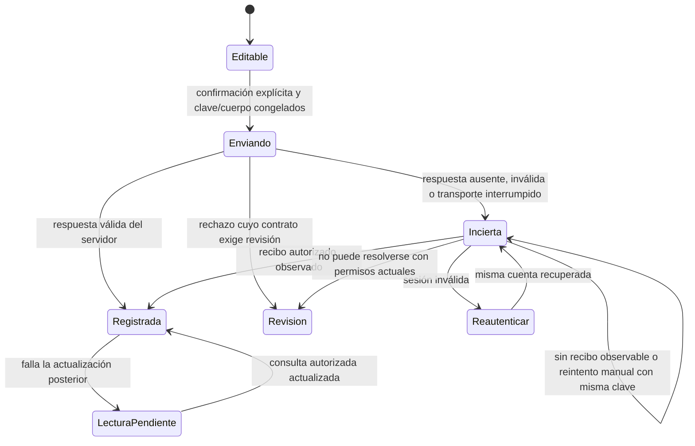

# Etapa 5 — experiencia integral y resiliencia de clientes

Fecha: **03/11/2026, America/La_Paz**. Estado: **propuesta para revisión**.
Solo **5A.1, diagnóstico y planificación**, está autorizado y se entrega ahora.
Los incrementos funcionales siguientes requieren aprobación posterior.
Base técnica: `desarrollo/etapa-4`, commit
`6b74f40e0cbe60355968ae9828560a2fa6b43d62`.

Este documento complementa el [plan maestro](PLAN_MAESTRO_10_ETAPAS.md).
La autorización posterior del propietario permite exclusivamente este diagnóstico,
sin reescribir las prohibiciones históricas de AGENTS ni los cierres de etapas1–4.
[Diagnóstico y trazabilidad de 5A.1](REPORTES/ETAPA_5_INCREMENTO_5A1.md).

## 1. Objetivo y fronteras

Mejorar la experiencia de pasajero/responsable, chofer y administración en la web
adaptable existente. Cubrir cinco bloques: móvil, conectividad intermitente,
perfiles, ayuda y valoraciones. PostgreSQL conserva toda autoridad de negocio.
No reconstruir reservas, colas, tarifas, identidad ni recuperación operativa.

- Conservar001–041 byte por byte y los contratos actuales de reservas/custodia.
- Seis plazas **simultáneas por segmento**, inventario APP/presencial único, grupos,
  consentimientos, tarifas/versiones pactadas y fila original se mantienen.
- Reserva, presencia, abordaje, salida, recepción y llegada siguen siendo hechos
  distintos. El cliente nunca los confirma por estar conectado o completar seis plazas.
- Solo laboratorio ficticio: sin despliegues, dinero, GPS, comunicaciones externas,
  proveedores de identidad ni servicios pagados. No iniciar Etapa6.
- No prometer atención, retención legal, devolución o permisos no acordados.
- No se implementan funciones, endpoints, tablas, migraciones, PWA o APK en5A.1.

## 2. Decisión de cliente: continuar con web adaptable

**Recomendación:** reutilizar React/TypeScript y el gateway local, manteniendo una
sola implementación del dominio en PostgreSQL. React Native/Expo y otras opciones
de ARQUITECTURA.md son propuestas históricas, no aplicaciones existentes.

| Necesidad | Web existente o ampliación propuesta | ¿Justifica Android ahora? |
|---|---|---|
| Reserva, grupos, recogida, manifiesto y administración | Flujos y componentes ya disponibles; mejorar navegación/estados | No; duplicaría superficies sin resolver un límite demostrado |
| Pantalla pequeña, teclado y lectores de pantalla | CSS adaptable, semántica y pruebas ya iniciadas; ampliar cobertura | No; falta medir problemas concretos en equipos objetivo |
| Reconexión con pestaña abierta | Reutilizar recibos, consultas y claves; diseñar estado común | No; la app nativa tampoco puede confirmar sin servidor |
| Recuperación tras recarga o caída | Contrato específico de ticket mínimo y autorización actual | No por sí sola; un APK también necesita contrato seguro de persistencia |
| Perfiles, ayuda y valoraciones | Extensiones acotadas al cliente/servicio existente | No requieren capacidades nativas |
| Primera apertura totalmente sin red | No garantizada: assets y API usan no-store; no hay service worker | Evaluar necesidad antes de elegir PWA/Android; no prometerlo |
| GPS/push/trabajo en segundo plano | Fuera de este alcance; requieren contratos posteriores | No usar funciones de Etapa6 como autorización implícita |

La decisión Android se reabre solo con requisitos aprobados, dispositivos/OS
objetivo, mediciones reproducibles y una capacidad necesaria que la web no pueda
cubrir razonablemente. Evaluar costo total de pruebas, accesibilidad, distribución,
actualizaciones y custodia de sesiones. Cualquier APK/emulador o cambio de transporte
necesita encargo separado; aquí no se instala SDK ni se contrata distribución.

Actualmente Playwright usa Desktop Chrome1440×1000 y Pixel7 emulado390×844.
No equivale a pruebas en Android físico, Safari/iOS ni hardware de terminal real.
El gateway escucha127.0.0.1: un teléfono externo no accede al localhost del equipo;
no resolverlo exponiendo el servicio a Internet o cambiando su seguridad a ciegas.

## 3. Requisitos transversales propuestos

| ID | Requisito verificable |
|---|---|
| E5-R01 | Mostrar éxito únicamente por una respuesta autorizada del servidor. Recibo recibido no implica CONFIRMED si el resultado es HELD; no implica salida ni abordaje. |
| E5-R02 | Conservar clave, familia de operación, cuenta y cuerpo congelado mientras el resultado sea incierto; no recalcular quote, partes, episodio o versión al reintentar. |
| E5-R03 | Diferenciar ausencia de red, demora, sesión inválida, rechazo de negocio, resultado incierto y lectura posterior fallida. |
| E5-R04 | No encolar ni reenviar escrituras automáticamente al reconectar, abrir otra pestaña o reiniciar. No Background Sync de comandos. |
| E5-R05 | Reconsultar sesión, permisos y estado real antes de una nueva intención. El servidor reautoriza cada operación; el estado local nunca concede roles. |
| E5-R06 | Aislar cuenta/asociación/viaje y descartar respuestas tardías. Ningún resultado antiguo repuebla la vista de otra cuenta. |
| E5-R07 | No cachear credenciales, tokens, CSRF, manifiestos, menores o datos privados en localStorage/IndexedDB/service worker. |
| E5-R08 | Una lectura antigua debe identificarse como tal; no mostrar plazas, precio o posición antigua como disponibilidad vigente. |
| E5-R09 | Paginación real, errores con recuperación, foco/teclado y controles utilizables en móvil, sin perder confirmaciones importantes. |
| E5-R10 | Perfiles no cambian membresías, verificación legal, responsable de reserva, compañía de menores ni titularidad histórica. |
| E5-R11 | Ayuda y valoraciones no registran movimientos físicos, corrigen custodia, alteran FIFO ni disparan sanciones o cancelaciones. |
| E5-R12 | Mantener Node22/24, PostgreSQL local, CSRF/Origin, RLS, auditoría, idempotencia y límites existentes. |

## 4. Contrato propuesto de recuperación

Es un diseño para aprobar, no un protocolo ya implementado universalmente.
El patrón de4A.6 se reutiliza, pero su guardia actual cubre comandos administrativos
específicos; no extenderla indiscriminadamente a todas las operaciones.

**Reglas del contrato:**

1. Antes del envío, congelar parámetros y precondición de precio/consentimiento.
   El fingerprint local identifica intención; no es una credencial ni un permiso.
2. Un timeout o AbortController cancela la espera del cliente, **no demuestra rollback
   del servidor**. El COMMIT puede haber ocurrido antes del corte.
3. Si hay respuesta válida, conservar su resultado aunque falle una lectura posterior.
   Repetir la lectura no debe repetir la escritura ni inventar su estado actual.
4. Si no llegó respuesta válida, consultar el estado autorizado y ofrecer únicamente
   reintento manual de la misma intención con la misma clave/cuerpo. Mis reservas
   ayuda, pero coincidencias de ruta/importe no prueban qué intento creó una reserva.
5. No clasificar automáticamente un resultado solo por HTTP400/401/403/409/503:
   depende del endpoint y la fase. En reservas la respuesta se enriquece después del
   COMMIT; una excepción posterior no demuestra que la escritura fue rechazada.
6. Sin sesión, ocultar datos privados y permitir reautenticar la cuenta original sin
   prestar la intención a otra cuenta. Con permisos revocados, mantener rechazo y
   revisión autorizada; nunca ampliar permisos para recuperar una acción.
7. La confirmación histórica no se renueva al reconectar: puede haber aceptación,
   caducidad, cancelación, otra tarifa o nueva asignación. Consultar estado actual.
8. BOARD/ALIGHT, salida y recepción solo se registran por actor legítimo y hechos
   observados. No reproducirlos como hechos nuevos desde una cola offline.
9. `navigator.onLine` es una pista de interfaz, no prueba de acceso ni autenticación.
   Empezar con consulta manual controlada; evitar tormentas de consultas o polling.
10. Clasificar consultas por contrato, no solo por método HTTP: varias lecturas
    existentes son POST autenticados con CSRF. Nunca reintentar cualquier POST.

### Consulta de recibo: dependencia por resolver en5A.2

No existe hoy una API web genérica de estado por clave de intento. `nexo.actions`
es interna y no tiene SELECT directo concedido a nexo_app. No abrirla al navegador.

Primero probar qué puede recuperarse mediante consultas autorizadas y reenvío nativo
con misma clave. Si se necesita desambiguación independiente del POST original,
proponer una proyección **cerrada**, inicialmente solo de reservas, por ejemplo
`/api/attempts/status` (nombre propuesto; inexistente en la base).

Contrato a revisar antes de programar: familia de operación admitida+clave técnica;
actor derivado de sesión, CSRF/Origin, parámetros cerrados y permisos actuales sobre
entidades resultantes. Devolver solo recibo mínimo autorizado y estado actual separado;
no payloads internos, tokens, SQL libre ni recibos de otro actor/asociación.

- RECORDED: hay un recibo propio autorizado; distinguir resultado original del estado
  actual y de su posible imposibilidad de lectura por cambio de permisos.
- NOT_OBSERVED: no se observó recibo en esa consulta. **No significa no ejecutada**:
  una petición puede seguir en curso o llegar después. Mantener incertidumbre y clave.
- Rechazo de acceso o revisión: no revelar si existe un recibo ajeno; no convertir
  la consulta en una vía para apropiarse de reservas presenciales o de menores.

Diseñar la serialización con los locks nativos, límites y reautorización tras espera.
Si hace falta RPC SQL, sería aditiva desde042 o la siguiente versión libre, tras
aprobación y con pruebas de upgrade/ACL/OID. No reescribir001–041 ni crear otra tabla
que pretenda ser el inventario o sustituir los recibos existentes.

### Persistencia: dos alcances distintos

- **Propuesta inicial:** RAM, pestaña abierta, sin nuevos almacenes. Mejorar navegación,
  recuperación de sesión y errores. No resuelve recarga forzada, cierre o caída.
- **Opcional5A.4, sujeto a decisión:** ticket mínimo por pestaña, versionado, ligado a
  entorno/cuenta/familia/clave, sin secretos ni cuerpo de reserva. No guardar manifiestos,
  menores, consentimientos, fechas legales o contraseña. Validar en servidor cada
  reanudación; descartar autoridad antigua y detectar reinicio efímero del laboratorio.

sessionStorage puede evaluarse para ese ticket; IndexedDB/service worker no son
necesarios por defecto. Una copia local no confirma operaciones. Borrar/caducar un
ticket no cancela reservas ni demuestra que una petición no se ejecutó. Plazos de
retención/acceso y política de terminal compartida requieren decisión, no TTL inventado.
No se promete recuperar un cuerpo perdido ni reenviar sin que el contrato lo permita.

## 5. Incrementos propuestos y dependencias

| Corte | Resultado previsto | Dependencia/gate |
|---|---|---|
| 5A.1 | Diagnóstico y este plan; sin código funcional | Encargo actual; revisión del propietario pendiente |
| 5A.2 | Recuperación coherente con pestaña abierta; piloto reserva/consultas, sin reenvío automático | Aprobar5A.1 y contrato de resultado/recibo; auditar clave nativa por operación |
| 5A.3 | Consolidación móvil, accesibilidad y extensión segura del patrón a paneles por rol | Contrato5A.2; validar cada comando antes de generalizar |
| 5A.4 | Recuperación tras recarga mediante ticket mínimo, si se requiere |5A.2, API/recibo suficiente y decisión de almacenamiento/privacidad |
| 5A.5 | Cuenta/perfil mínimo y preferencias de interfaz | Sesión/reautenticación; decisión de campos; nunca editar privilegios |
| 5A.6 | Ayuda contextual local por rol y estado | Textos/políticas aprobados; integración con estados5A.2–3 |
| 5A.7 | Valoraciones de laboratorio, si se aprueba su contrato | Identidad/autoridad existente y decisiones de elegibilidad, visibilidad/moderación |
| 5A.8 | Auditoría integral y cierre técnico propuesto de Etapa5 | Incrementos aceptados, cobertura y límites pendientes explícitos |

**Orden recomendado:**5A.2 →5A.3; decidir5A.4 antes de prometer recuperación tras
recarga; continuar con5A.5 y5A.6, luego5A.7 condicionado y auditoría5A.8. El contenido
estático de ayuda puede prepararse independientemente de cambios SQL o de perfiles;
no bloquear ese trabajo por decisiones de valoraciones. No se reserva numeración
SQL ni se inicia ninguno de estos cortes funcionales con este documento.

### Alcance propuesto exacto de5A.2

**Incluido, tras aprobación del plan:**

1. Piloto sobre la reserva APP existente de Checkout y sus consultas propias:
   QUEUE/ENROUTE conforme a su contrato, sin cambiar asignación terminal, aceptación
   de recogidas, expreso, partes de grupo o tarifa pactada.
2. Estados de cliente distinguibles: envío, resultado incierto, recibo registrado,
   lectura posterior pendiente, reautenticación y revisión. No son estados nuevos
   de bookings ni un segundo registro de capacidad.
3. Mantener en memoria cuenta, clave y cuerpo congelados durante navegación interna
   controlada y reintentos manuales. La cuenta distinta no puede recuperar el intento.
   Ante recarga/cierre forzado, advertir la limitación sin prometer persistencia.
4. Reutilizar Checkout, private-api, consultas propias y el patrón probado de
   useCommands/admin-intent donde corresponda. Inventariar contratos de refresh y
   no modificar todos los callers o comandos administrativos por defecto.
5. Consultar resultado y estado actual de forma autorizada. Evaluar primero las
   consultas/replays existentes; solo si resultan insuficientes, añadir la proyección
   cerrada de recibo descrita arriba. Ese endpoint y cualquier RPC aditiva deben
   revisarse antes de programarlos; el nombre propuesto no acredita que ya existan.
6. Pruebas dirigidas con POST/COMMIT real y testigo PostgreSQL, más regresiones de
   aislamiento, grupos, precio y capacidad. Después, batería completa y CI del
   commit funcional aprobado, sin ampliar timeouts/retries.

**Fuera de5A.2:** almacenamiento persistente/ticket de5A.4, colas o reenvíos
automáticos, primera apertura offline, PWA/Android, perfiles editables, ayuda nueva,
valoraciones, correcciones de hechos físicos, cambios de roles o políticas de
negocio. La extensión general a operación de chofer/administración pertenece al
corte posterior, con análisis individual de sus comandos.

**Aceptación mínima:** misma cuenta+misma clave/cuerpo producen como máximo una
actuación nativa; no se renueva una intención incierta; recibo confirmado se conserva
si falla refresh; NOT_OBSERVED mantiene incertidumbre; sesión/permiso revocados
impiden lectura/escritura indebidas. Se conservan reservas, precios, FIFO y máximo
seis por segmento. La persistencia tras reload no se declarará cubierta por este corte.

### Contratos, pruebas y aceptación por corte

| Corte | Contrato y módulos candidatos | Pruebas necesarias | Criterio de aceptación |
|---|---|---|---|
| 5A.1 | Evidencia → brecha → requisito → gate; archivos documentales nuevos | Enlaces, alcance Git, hashes001–041; no matrices funcionales | Plan trazable, sin código/migraciones modificados y sin confundir propuesta con implementación |
| 5A.2 | Checkout/useCommands/private-api; consulta de recibo solo si necesaria | Corte antes del envío, COMMIT con respuesta perdida, fallo de enriquecimiento/refresco, cuenta distinta, TTL, doble clic y reintento concurrente; PG real para efectos | Un intento no duplica plazas/eventos; no éxito sin respuesta autorizada; incertidumbre no crea clave nueva; refresh fallido no borra recibo conocido |
| 5A.3 | Componentes actuales, navegación/errores/confirmaciones y roles | Playwright desktop/mobile,320px como objetivo propuesto, zoom200%, teclado, foco, texto largo, errores y reconexión; no pruebas de cada estilo como implementación | Recorrido completo utilizable por cada rol, sin overflow que impida operar; acciones sensibles y permisos conservados |
| 5A.4 | Ticket mínimo y reanudación de lectura; ninguna cola de comandos | Reload antes/después de COMMIT, dos pestañas, cuenta distinta, cierre de sesión, reinicio LAB, ticket manipulado y cambio de permisos | Nunca expone datos anteriores ni reenvía escrituras solo por abrir la app; límites de recuperación y retención aprobados |
| 5A.5 | Cuenta propia, preferencias permitidas; facade de identidad existente | Autoridad derivada de sesión, intentos de editar rol/asociación/responsable, claves ajenas, revocación y accesibilidad | Solo campos explícitamente aprobados; sin PII real, escalamiento de roles o cambios en reservas/custodia |
| 5A.6 | Ayuda local versionada en la web; enlaces a módulos existentes | Contenidos por rol/estado, navegación, lectura con shell ya cargada sin red, ausencia de scripts externos y de escrituras | Distingue información, incidencia y revisión; no promete comunicaciones, plazos o asistencia inexistentes |
| 5A.7 | Valoración separada de incidencias/discrepancias; nueva persistencia solo si aprobada | Elegibilidad, grupos/menores, duplicados/concurrencia, visibilidad A/B, edición/versiones e idempotencia | Modelo comercial aprobado y ningún efecto en inventario, precio, fila, custodia o sanciones |
| 5A.8 | Trazabilidad completa y límites de entrega | Unitarias, PostgreSQL, E2E ambos proyectos, TS/build, cierres/reinicio, CI Ubuntu/Windows Node22/24 y CodeQL del SHA final | Resultados reales publicados y revisión funcional; solo laboratorio, sin declarar producción |

Perfiles: comenzar por información mínima de cuenta propia y preferencias no
sensibles. El login actual no es un perfil editable; códigos de responsabilidad y
atestaciones de plataforma no son campos de autoservicio. Registro público, cambio
de contraseña o recuperación pública no se dan por disponibles por existir el
módulo interno de identidad; requieren contratos específicos, sin correo/SMS/OAuth.

Ayuda: priorizar reserva frente a cotización, incertidumbre, ofertas HELD, llegada,
abordaje, recogida, sustitución, recepción y revisión humana. El código LAB de contacto
no es teléfono de soporte. Conocer ayuda en una pestaña cargada no significa que
pueda abrirse por primera vez sin red. No ampliar no-store para cachear datos privados.

Valoraciones: decidir por separado viaje y aplicación. Propuestas para discutir:
autor legitimado, viaje elegible, unidad de voto por grupo/reserva/cuenta y si existe
texto libre. No fijar escala, plazo, publicidad o una estrella por persona sin acuerdo.
Empezar con visibilidad interna/estructurada es una opción, no una política aprobada.
No reutilizar passenger_discrepancies/care reviews como una tabla de puntuaciones;
no insertar notas en historial de hechos físicos ni automatizar penalizaciones/ranking.

## 6. Decisiones reservadas al propietario/comprador

| ID | Decisión | Bloquea | Trabajo independiente seguro |
|---|---|---|---|
| D01 | Navegadores, dispositivos y objetivos de accesibilidad/UX aceptados | Aceptación multiplataforma y eventual Android | Mantener web y pruebas emuladas actuales; proponer objetivos adicionales sin certificarlos |
| D02 | ¿Se exige recuperación tras reload/caída? Almacenamiento, retención y terminal compartida |5A.4 y promesa de continuidad persistente |5A.2 en memoria, sin escribir datos en navegador |
| D03 | Campos de perfil, edición, privacidad y recuperación de acceso | Autoservicio de identidad/campos persistentes nuevos | Cuenta mínima de solo lectura y preferencias ficticias efímeras |
| D04 | Responsable de ayuda, actualización, escalamiento y compromisos de atención | Publicar soporte como servicio/compromiso | Guía contextual local que señala límites y revisión existente |
| D05 | Objetivo, elegibilidad, unidad de voto, escala, visibilidad, texto y moderación | Implementación5A.7 | Requisitos y maquetas documentales, sin guardar/publicar valoraciones |
| D06 | Retención/borrado/exportación, menores, identidad y acceso histórico | Uso comercial de perfiles/tickets/valoraciones | Solo datos ficticios y contratos existentes de permisos/custodia |
| D07 | Necesidad demostrada, distribución y mantenimiento de Android | Cualquier cliente nativo | Web adaptable; ninguna instalación o contratación |

Ninguna decisión pendiente autoriza cambiar ausencias, ofertas120s provisionales,
revisión legal de menores, reservas futuras tras revocación, cancelaciones o reglas
económicas. Se preservan los contratos vigentes y los bloqueos de revisión humana.

## 7. Estrategia de pruebas y gates de aprobación

Durante implementación futura: pruebas dirigidas por frontera, con fixtures locales
y testigos PostgreSQL independientes para verificar reservas/eventos/capacidad.
No basta con que la UI diga éxito o con interceptar todas las respuestas con mocks.
Simular pérdida de respuesta **después de un COMMIT real**, desconexión antes del
POST y reconexión/cambio de sesión; nunca usar datos reales ni un proveedor externo.

Al estabilizar código funcional, ejecutar comandos existentes de package.json:
`npm run test:all`, `npm run test:web`; comprobar `web:check`/`web:build` incluidos
según los runners, cierres y reinicio. Mantener la matriz distribuida actual de12
jobs por evento y la mitigación Chromium Windows; no aumentar timeouts/retries o
límites para ocultar fallos. Registrar nuevas definiciones frente a ejecuciones.

La referencia histórica de6b74f40 es77 unitarias+406 PG+69 E2E=552 casos distintos,
621 ejecuciones al contar ambos dispositivos; CI24/24 y CodeQL ratificados en el
PR #5. No son pruebas reejecutadas por este plan. No fijar un total futuro antes
de diseñar/ejecutar los casos. Cualquier cambio SQL exige instalación limpia,
upgrade ficticio poblado, reaplicación, hashes/OID/grants y conservación histórica.

Aceptar5A.1 significa revisar alcance, orden, decisiones y criterios anteriores;
no aceptar automáticamente las políticas propuestas ni autorizar5A.2–8, Android,
servicios o producción. No se modifica ningún PR existente ni se inicia Etapa6.
