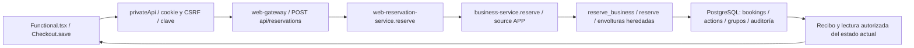

# Etapa 5, incremento5A.1 — diagnóstico y planificación técnica

Fecha: **03/11/2026, America/La_Paz**. Repositorio `pepoj1046-svg/proyecto-nexo`.
Base exacta: `6b74f40e0cbe60355968ae9828560a2fa6b43d62`, cierre técnico LAB de Etapa4.
Rama local de entrega: `planificacion/etapa-5a1`. Estado: **diagnóstico entregado;
plan pendiente de revisión/aprobación**. No hay implementación funcional de Etapa5.

## 1. Preparación y método

Se comprobó remoto correcto y árbol limpio. La sesión estaba en la rama de skills
`9f62bd0`; se creó una rama local independiente desde la base6b74f40 indicada por
el propietario. No se fusionaron las skills, PR #6, PR #5 ni etapas anteriores.
La autorización nueva permite5A.1 documental y prevalece sobre las prohibiciones
históricas de iniciar Etapa5 en AGENTS/plan maestro. Esos archivos no se reescriben.

Se revisaron AGENTS, plan maestro, cierre4A.6, requisitos, arquitectura/modelo y
secciones pertinentes de contratos de negocio, identidad, cuidados y administración.
Se contrastaron con cliente React, gateway, servicios y funciones SQL de reserva,
no solo con el diseño conceptual antiguo. El borrador inicial de apps nativas,
licencias o GPS no se considera funcionalidad existente.

El catálogo local de skills devolvió `[]`; las15 skills de nube no incluyen Nexo.
Las seis instrucciones de arquitectura, seguridad, base de datos, pruebas, calidad
y auditoría se leyeron manualmente en el checkout9f62bd0 previo, como listas de
comprobación. **No se declara activación nativa ni invocación real.** Se usaron
AGENTS, trufis-dev y contratos vigentes; no se copiaron skills a la base de Etapa4,
no se instalaron herramientas ni se inició otro agente/modelo.

## 2. Diagnóstico por los cinco bloques

| Bloque | Implementado y reutilizable | Brecha real para Etapa5 |
|---|---|---|
| Móvil | Web React/TypeScript, CSS adaptable, menú, foco visible, skip-link, reduced-motion y controles semánticos; paneles de todos los roles | Consolidar recorridos y estados de error, formularios largos, teclado/zoom y objetivos de dispositivos. Solo existe emulación Chromium, no APK ni certificación física/iOS |
| Conectividad | AbortController/timeouts, errores, protección de respuestas antiguas, claves por intención, consulta de reservas; guardia/reautenticación administrativa4A.6 | No hay estado transversal online/offline, recuperación universal tras navegación/recarga ni API web de consulta por clave. Las claves viven en memoria |
| Perfiles | Login/logout local; `/api/session` proyecta accountRef/operator; roles y vínculos gestionados por SQL; cuentas y recuperación de identidad existen como módulos confiables | No hay perfil de pasajero editable ni preferencias persistentes de producto. Roles, responsables presenciales y perfiles de paradas no son perfiles personales |
| Ayuda | Textos de laboratorio, mensajes explicativos/errores, confirmaciones, incidencias, discrepancias y revisión autorizada | No hay centro de ayuda/contexto unificado, catálogo de preguntas ni política de soporte. Un código de contacto LAB no es canal real |
| Valoraciones | Requisito histórico de valorar viaje y app; reportes operativos y revisiones ya existen | No se encontró módulo de puntuación/feedback de producto. Incidencias/discrepancias no equivalen a valoraciones; modelo y políticas pendientes |

Evidencia de móvil: [styles.css](../../apps/web/src/styles.css),
[main.tsx](../../apps/web/src/main.tsx),
[configuración Playwright](../../playwright.config.mjs),
[app.spec](../../tests/web/app.spec.mjs) y pruebas funcionales por rol.
Los proyectos reales son desktop1440×1000 y Pixel7 emulado390×844.

Las búsquedas acotadas del cliente/servidor no encontraron uso de navigator.onLine,
listeners online/offline, visibilitychange, serviceWorker, IndexedDB, localStorage
ni sessionStorage. Esto identifica una brecha de cliente, no autoriza añadirlos
indiscriminadamente ni demuestra una vulnerabilidad explotada.

## 3. Trazado comprobado de reserva existente

| Frontera | Evidencia real y responsabilidad |
|---|---|
| UI | [Functional.tsx:29](../../apps/web/src/Functional.tsx#L29), Checkout: quote, consentimiento, cuenta y `attempt` con clave/cuerpo congelados. No confirma con cálculo local |
| Transporte | [private-api.ts:4](../../apps/web/src/private-api.ts#L4): cookie same-origin, CSRF, Idempotency-Key, timeout18s; sincroniza lecturas de sesión con login/logout. [api.ts](../../apps/web/src/api.ts) es la capa pública de consulta, timeout8s |
| API | [web-gateway.mjs:48](../../src/http/web-gateway.mjs#L48), secured/authenticated y handler fijo POST `/api/reservations`; Host/Origin/CSRF y sesión. Respuestas no-store, política CSP, sin geolocalización |
| Servicio web | [web-reservation-service.mjs](../../src/db/web-reservation-service.mjs), journeyRequest/reserve: campos cerrados, puntos ordenados,1–6, flow/modalidad y quote. QUEUE delega en business.reserve; ENROUTE usa reserve-enroute nativo |
| Transacción | [business-service.mjs:7](../../src/db/business-service.mjs#L7): runtime nexo_app, READ COMMITTED, token solo servidor y consulta parametrizada a reserve_business; APP fijado por servidor |
| SQL | [012](../../database/migrations/012_business_operations.sql) compara tarifa/importe con instantáneas reales; [029](../../database/migrations/029_queue_assignment.sql) conserva recibos y asigna terminal/expreso por turno sin BOARD/salida. Las envolturas heredadas llegan al inventario nativo [002](../../database/migrations/002_operations.sql) |
| Fuente de verdad | Bookings y miembros/grupos, tarifas originales, acciones por actor/clave y auditoría SQL; una lectura/copia del cliente no es otro inventario |

Hay un punto importante para resiliencia: el servicio web obtiene primero el recibo
transaccional y después ejecuta `own`/`business.booking` para construir la respuesta.
Un fallo de esa fase puede dejar escritura confirmada sin respuesta utilizable.
No clasificar el desenlace únicamente por HTTP ni renovar intención automáticamente.

Los POST de operaciones, seguridad, cuidados, recuperación y administración conservan
sus servicios/RPC propios. No se propone envolverlos todos con una nueva API de
negocio universal ni reemplazar sus contratos de episodio, revisión o custodia.

## 4. Reutilización y brechas concretas

| Evidencia | Reutilizar | Límite/acción propuesta |
|---|---|---|
| [Functional.Checkout](../../apps/web/src/Functional.tsx#L29) | Misma clave/cuerpo por cuenta y bloqueo de parámetros tras enviar; cotizaciones tardías descartadas | El intento está en useRef; cierre/reload/navegación que desmonta pueden perderlo. La guardia administrativa no cubre este flujo universalmente |
| [useCommands](../../apps/web/src/use-command.ts) | Previene doble envío, conserva claves inciertas y separa rechazo de algunos comandos administrativos | Inventariar cada caller/refresh: no generalizar clasificación HTTP ni retiros de intención a reservas/enriquecimiento |
| [admin-intent](../../apps/web/src/admin-intent.ts) y [main](../../apps/web/src/main.tsx#L19) | Guardia SPA/beforeunload, login de la cuenta original, memoria sin secretos persistentes | Protección acotada a familias administrativas. No persiste al cerrar proceso; no es autorización de servidor |
| [Operations.BookingJourney](../../apps/web/src/Operations.tsx#L20) | Consulta propia de progreso y hechos separados | Su refresh captura errores sin relanzar. Reproducir en5A.2 el efecto de POST correcto+refresco fallido antes de decidir si necesita cambio; no declarar fallo de seguridad sin ejecución |
| [PrivateReservations](../../apps/web/src/Functional.tsx#L41) y [Management](../../apps/web/src/Management.tsx) | Listados propios, cursores, descarte generacional y limpieza al salir/cambiar cuenta | Conservar aislamiento al añadir estados stale/reconexión; no usar un listado coincidente como prueba de recibo de una clave particular |
| [web-sessions](../../src/http/web-sessions.mjs) | Contextos opacos acotados en RAM, CSRF rotado, revocación SQL y logout | Reinicio pierde contexto; nueva sesión no crea autoridad anterior ni prolonga TTL. Recuperación pública de contraseña no está expuesta por el gateway web actual |
| [040](../../database/migrations/040_authorization_review_revalidation.sql) y [041](../../database/migrations/041_administrative_receipt_reads.sql) | Revalidación tras espera y lectura de recibos administrativos sin mutex de escritores | No son una API universal de recuperación; conservar permisos y no abrir helpers/tabla actions al cliente |

Una petición abortada puede seguir en PostgreSQL. Un recibo confirmado y el estado
actual deben mostrarse separadamente: HELD vencido no consume igual que CONFIRMED,
ni una reserva confirmada equivale a salida. Se mantienen precios/versiones,
partes de grupos, recogidas posteriores y restricciones de menores/responsables.

## 5. Cobertura existente y cobertura a añadir

Pruebas **inspeccionadas, no reejecutadas en5A.1**:

- [functional.spec](../../tests/web/functional.spec.mjs): reserva real, pérdida de
  respuesta tras COMMIT y misma clave sin duplicado; cambio de cuenta y respuestas tardías.
- [checkout-races](../../tests/web/checkout-races.spec.mjs): cotización antigua,
  cambio de plazas/puntos y recorrido habilitado.
- [web-auth-order](../../tests/web-auth-order.test.mjs) y
  [web-sessions](../../tests/web-sessions.test.mjs): orden cookie/sesión, revocación,
  CSRF, expiración y ausencia de tokens SQL en el navegador.
- [driver-admin-races](../../tests/web/driver-admin-races.spec.mjs),
  [platform-admin-races](../../tests/web/platform-admin-races.spec.mjs) y suites fleet/
  route-config: intención incierta, refresco403, navegación y cuenta original.
- [integración PostgreSQL](../../tests/integration/postgres.test.mjs): concurrencia,
  capacidad, reserva/grupo, ámbitos/RLS, precios, migraciones, sesión y recibos.

Ampliaciones propuestas: cortes antes/después de COMMIT, enriquecimiento fallido,
resultado conocido con snapshot fallido, reconexión con sesión caducada/revocada,
actor distinto, dos pestañas, nueva tarifa/episodio/custodia mientras falta respuesta,
lecturas tardías, y ausencia de recibo que no prueba rollback. Reload/caída requieren
un contrato específico antes de exigir persistencia en las pruebas.

Conservar testigo SQL de efecto real: número de reservas/eventos, precio/versión,
partes, máximo seis por segmento y estados físicos. Probar no solo textos de UI.
Valorar casos de perfil, ayuda y rating cuando sus contratos existan, sin inventar
puntuaciones o plazos para aparentar cobertura.

Referencia histórica de cierre6b74f40: **77 unitarias,406 PG,69 E2E distintos**,
552 casos;621 ejecuciones con desktop/mobile. CI24/24 y CodeQL según ratificación
[PR #5](https://github.com/pepoj1046-svg/proyecto-nexo/pull/5). Esa evidencia histórica
no es una ejecución nueva de este incremento ni acredita otros navegadores/producción.

## 6. Riesgos heredados y decisiones

1. Activación comercial, geocatálogo, REVIEWER/permisos y primera fila aún requieren
   preparación LAB/offline. Etapa5 no debe simular que esos recursos aparecen por
   recuperar conectividad o editar un perfil.
2. Pérdida total de GENERAL_ADMIN, identidad legal/profesional, retención/exportación,
   menores y custodia requieren contrato del comprador. Mantener revisión humana.
3. HTTP loopback/no-store, sesiones efímeras y límites120/min/seis concurrentes son
   laboratorio. Despliegue/TLS/MFA/escala/restauración corresponden a autorización e
   infraestructura posteriores, no a un APK o service worker añadido por comodidad.
4. Retención de recibos y tickets debe ser coherente. No borrar claves pendientes
   para desbloquear UI ni cancelar reservas al detectar offline.
5. Un historial legacy>64 puntos, una revisión/consentimiento obsoletos o custodia
   pendiente no pueden corregirse desde el cliente para permitir reintento.
6. Ayuda requiere responsable y política de respuesta. Valoración necesita target,
   elegibilidad, escala, unidad de voto, edición, moderación y visibilidad; no hay
   aprobación de publicidad, texto libre, rankings o efectos económicos.
7. Capturas privadas siguen sujetas al bloqueo previo: no publicar por otra vía.
   Safari/Android físico/condiciones de red reales y métricas de producto siguen sin
   validar. Ninguna ausencia de pruebas justifica declarar soporte o ahorro medido.

Las decisiones y qué trabajo puede continuar sin ellas están en D01–D07 del
[plan de implementación propuesto](../PLAN_ETAPA_5.md).

## 7. Entrega y verificación documental

Se crean únicamente este informe y `docs/PLAN_ETAPA_5.md`, sin cambiar código,
AGENTS, planes/cierres anteriores, configuración, lockfile, workflows o001–041.
Se verifican enlaces locales, ubicación/alcance del diff, identidad de la base,
refs de ramas anteriores y hashes de las41 migraciones.

Durante la elaboración local de5A.1 no se ejecutaron npm, PostgreSQL, Playwright,
TypeScript/build ni workflows de CI: no hay cambio funcional y las pautas de pruebas
recomiendan no repetir matrices pesadas por Markdown. No se generaron evidencias
funcionales nuevas ni se iniciaron servicios, instalaciones o despliegues.

La entrega posterior autorizada para revisión publica únicamente estos dos Markdown
en `planificacion/etapa-5a1`, mediante commit documental y PR independiente hacia
`desarrollo/etapa-4`, sin fusionarlo. El SHA publicado, número de PR y estado de
cualquier CI automática se registran en su descripción. Crear esa entrega no
constituye ejecución ni aprobación de pruebas funcionales nuevas; los resultados
de Etapa4 citados arriba son históricos. No se modifican los PR anteriores.

**Conclusión:** mantener web adaptable y comenzar, tras revisión, por el contrato
seguro de incertidumbre5A.2; consolidar móvil5A.3 y decidir persistencia5A.4 antes de
prometer recuperación tras reload. Después perfiles mínimos, ayuda y valoraciones
condicionadas. La propuesta no autoriza programación ni inicia Etapa6.
